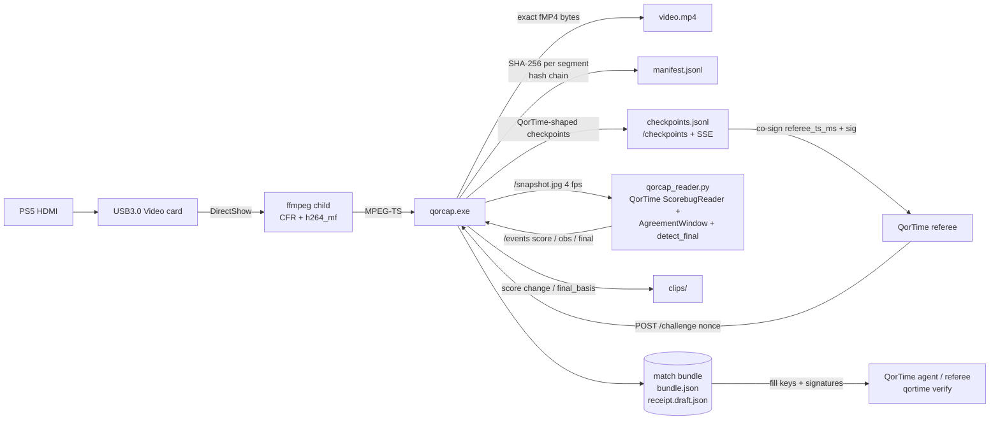

<p align="center"></p>

# QorCap

**Website:** https://conwan30.github.io/qorcap/ · **Download:** [v0.3.34](https://github.com/ConWan30/qorcap/releases/tag/v0.3.34) ([latest release](https://github.com/ConWan30/qorcap/releases/latest))

A small Windows recorder for a USB HDMI capture card (built for a generic **"USB3.0 Video"** card carrying a PS5),
made for **[QorTime](https://github.com/ConWan30/qortime)** match receipts. It does two jobs:

1. **Keep recording when things go wrong.** If the card is unplugged, replugged, held by another app or the
   driver freezes, QorCap notices and reopens the device. A recorder that sits on a frozen device and never
   recovers is the problem this replaces.
2. **Produce evidence QorTime can use.** Every encoded video segment is hashed into a SHA-256 chain. It emits
   checkpoints in QorTime's format that a referee can co-sign, records when referee nonces arrive, runs
   QorTime's own scorebug reader inline, auto-saves clips, and writes a **match bundle** with a draft
   `qor-receipt/v0`.

> **What this proves, and what it does not.** A QorCap bundle shows the **integrity and timing** of the
> footage: which exact video bytes, in what order, seen when, and (once a referee co-signs the checkpoints)
> no later than the referee's clock. It does **not** show **who is holding the controller**, and it gives no
> cryptographic proof of player identity. Identity and liveness of the *player* are QorTime's job (player
> keys, the HID nonce response, dual-attested mode).

Design inspiration: [rec-rs](https://github.com/michaelshimeles/rec-rs) (a small, single-purpose recorder
with a local control surface). QorCap copies only that design idea, no code. No OBS code is used either.

## Quickstart: double-click Start Match

1. Download `qorcap-v0.3.34-windows-x64.zip` from the [latest release](https://github.com/ConWan30/qorcap/releases/latest)
   and unzip it, for example to `C:\QorCap` (right-click the zip, *Extract All*).
2. Connect PS5 HDMI out to the **USB3.0 Video** card, and the card to a blue USB 3 port. Close OBS or the Camera app.
3. Double-click **`Start Match`**. On the first run it downloads ffmpeg, installs Python 3.12 through winget if it
   is missing, and sets up its Python packages in `%LOCALAPPDATA%\QorCap\venv`. This happens once.
4. Play. The Start Match window is a QorCap console: match state, capture fps, controller, referee link, score, disk, and elapsed time. A referee challenge takes the window over with the button pattern and a countdown. `Start Match.cmd --plain` (or `QORCAP_PLAIN=1`) keeps the old one-line status. `NO_COLOR` keeps the new layout without color. Preview the console without recording anything: `py sidecar\qorcap_console.py`.
5. Recording stops by itself when the final score is read from Madden's **end-of-game menu** (authoritative; a scorebug-only final waits up to 120 s for that menu). After a committed end screen (3 frames over 3 seconds) or a posted end-menu / final-screen final, capture keeps going for `QORCAP_POST_FINAL_TAIL_S` seconds as well (default 10, clamped to 0–60). That tail only adds time: it does not shorten the 4 s end-menu hold or the 120 s scorebug wait. Set it to `0` for the older stop. Enter or Q still stops at once. What actually happened (why the tail started, start and stop time, actual seconds) is `post_final_tail.json` in the match folder. It is not part of the receipt. You can also press **Enter** (or Q, or Ctrl+C).
6. It signs `receipt.json`, runs `qortime verify` and `qorcap verify-bundle`, prints **VERIFIED / PARTIAL / FAIL**,
   and opens the match folder (`Documents\QorCap Matches\match-YYYYMMDD-HHMMSS`).
7. To view it online, open https://conwan30.github.io/qortime/verify/, click *Choose file* and pick `receipt.json`
   (or paste its text), paste the contents of `referee.pub` into the key box, then click *Verify*. It runs in the browser and
   uploads nothing.

Start Match records with the settings that worked on the first real test (laptop MyTurn, **USB3.0 Video** card):
`--input-format mjpeg`, 1280x720, 30 fps, `h264_mf` (29.7 fps measured). That card lists raw `yuyv422` only at 1920x1080
and up, so for `--input-format auto` QorCap now runs `-list_options` and picks mjpeg when the requested size is not
offered raw. Card audio is its own DirectShow audio device (`Digital Audio Interface (USB3.0 Audio)`), so it is
opened as a second `-f dshow -i audio=...` input. Both inputs are wall-clock stamped and audio goes through
`aresample=async`. If the audio device cannot be opened, QorCap logs a warning and records **video-only**, so it does not
keep reopening. If OBS (`obs64.exe`) is running, you get **"Close OBS. It's using the capture card"** and Start Match
offers to close it for you. A failure is only reported as "busy" when ffmpeg says the device is busy or in use.

**Finalize after the fact (offline).** If the live score reader missed the game, or you recorded with `qorcap record --bundle`,
double-click **`Finalize Last Match`** (or run `qorcap finalize <bundle folder>`). It decodes `video.mp4` at 4 fps,
runs the same QorTime `ScorebugReader` + `AgreementWindow` + `detect_final`, and writes `timeline.offline.jsonl`,
`score_checkpoints.jsonl` (a QorTime-shaped hash chain over the score changes and the final, each bound to the video
chain head) and `final.offline.json`. Then it signs `receipt.json` the same way Start Match does. If Start Match
countersigned live (`countersigned.jsonl`), those signatures are reused. Otherwise the local referee countersigns QorCap's
checkpoints at finalize time, stamping each with QorCap's recording time, and `referee.key_kind` is
`local-self-attested-offline` so a reader can tell.

**Glimpse witness (on in Start Match).** Start Match sets `QORCAP_GLIMPSE_FRAME=1` (so `GET /frame/scorebug` is served), starts the advisory watcher, and turns on `QORCAP_GLIMPSE_WITNESS` (unhinted read of locked frames, about $0.08/match), `QORCAP_GLIMPSE_BURST` (one extra crop on a disagreement, about $0.006/match), and `QORCAP_GLIMPSE_ATTEST` (signed sidecar after the match, $0, its own key). Together about $2/week at 25 matches if the quotas fill, under the default $10/week and $0.50/game caps. Nothing here feeds a lock or a receipt. `--no-glimpse` turns all of it off. `--no-glimpse-witness`, `--no-glimpse-burst`, and `--no-glimpse-attest` each turn one switch off. `QORCAP_GLIMPSE_BURST_RING`, `QORCAP_GLIMPSE_CLIP_AUDIT`, and the touchdown veto `QORCAP_GLIMPSE_TD_VETO` stay off. `qorcap record` itself stays default-off. See [docs/GLIMPSE_WITNESS.md](docs/GLIMPSE_WITNESS.md).

**Highlight clips (automatic after the match).** Start Match and Finalize Last Match cut them once the receipt is signed.
Opt out with `--no-auto-highlights`. You can still double-click **`Make Highlights`** (or run `qorcap highlights <bundle folder>`).
For every **locked** score change (a `score_change` checkpoint in the signed hash chain whose
evidence hash matches, normally inside `receipt.json`) it cuts about 8 s before to 4 s after (`--pre`/`--post`) and burns in a small panel
titled **SCOREBUG LOCK** (the QorTime viewer's wording for a scorebug read), with the score in gold plus the lock and receipt hashes.
The panel and the `.vtt` stay on **SCOREBUG LOCK** (`--no-burn` stream-copies and keeps those words only in the `.vtt`). They do not say
**VERIFIED**. It writes `highlights/manifest.json` (`qorcap-highlights/v0`) linking each clip to its lock, the receipt SHA-256 and the
hash-chained source segments. `qorcap highlights --check highlights/manifest.json` re-checks all of it. It never runs during recording: a fresh
`.qorcap-run/recording.lock` makes it refuse (exit 3), and it needs the signed `receipt.json` (exit 4 without it). A highlights failure does
not change the receipt, the finalize result, or submission. Scorebug misreads that a later lock contradicts are skipped and listed. Clips show
what was on screen, not who held the controller.

**Content Credentials.** After those clips are cut, Start Match signs each one with `qorcap clip sign` when the receipt verifies.
`verified: true` is written only when QorTime's verifier returns `VERIFIED` and `qorcap verify-bundle` is clean. A local receipt stays
`self_attested` with `verified: false`. If the receipt does not verify, the clips are still exported, without credentials, and the manifest
records `verified: false` and `receipt did not verify`. `qorcap clip export` is a separate one-range cut and stays default-off
(`--content-credentials` or `QORCAP_CONTENT_CREDENTIALS`). With that flag off, its output is the ffmpeg cut and nothing else.
See [docs/CONTENT_CREDENTIALS.md](docs/CONTENT_CREDENTIALS.md).

No card? Double-click **`Test Without Card`**. It plays a test-pattern video and a scripted 20-second game through the same
record, sign and verify path (`python sidecar/qorcap_match.py --test-pattern`).

**Trust level: self-attested until submit.** The launcher signs as the player with a
device key (QorTime `FileKey`, `%LOCALAPPDATA%\QorCap\keys\device.key`, ACL limited to your Windows user, never printed)
and countersigns every checkpoint live with a **local** referee key (`referee.key`, same protections). It uses QorTime's
own `checkpoints.countersign`, `receipt.build`, `sign_referee` and `sign_player`. The receipt's computed QorTime tier is
`single-attested` and `referee.key_kind` is `local-self-attested`, so anyone checking it can see the "referee" is the same PC.
The public QorTime referee is live at `https://qortime-referee-production.up.railway.app`. `qorcap submit` asks that
referee to replace the local signature. Until a submission is accepted, the receipt on disk stays `local-self-attested`.
With no referee challenges or HID motion, `qortime verify` gives **PARTIAL**: signatures, the checkpoint chain and the
video hashes are all checked, and challenges and motion are listed under "not checked". **FAIL** means something was altered or broken.
This proves the footage was not edited after it was recorded. It does not prove who was playing, and the PC's owner could
produce a self-attested receipt. An independent referee is needed for more than that.

Files in the match folder: `video.mp4`, `clips/`, `manifest.jsonl`, `checkpoints.jsonl`, `receipt.json` (signed),
`receipt.draft.json`, `referee.pub`, `verify.txt`, `qorcap.log`, `console.log`, `countersigned.jsonl` (live
referee countersignatures); after finalize also `timeline.offline.jsonl`, `score_checkpoints.jsonl`, `final.offline.json`; when the final was
confirmed from the recording's last minutes at stop, `final.tail.json` and `clips/final-recorded.mp4`.

QorTime code: the zip bundles a pinned copy (`qortime/`, commit `0204e6d`, includes the PSN name check (`match.observed_handles`), `qortime referee-ai`, `end_menu_read`, official-review (verified uploads) and challenge rule v2 verification). If it is missing, the launcher downloads that
pinned commit's zip once into `%LOCALAPPDATA%\QorCap`.

## Stack and why

**Rust (one ~1.6 MB `qorcap.exe`) controlling a separate `ffmpeg.exe`** (DirectShow input, Media Foundation
H.264 hardware encoder `h264_mf`, AAC).

- I chose this over a native `windows`-crate Media Foundation pipeline because MF capture plus encoding
  can't be tested from Linux. Writing it blind risked shipping something that doesn't work. ffmpeg's
  `dshow` + `h264_mf` path is proven on exactly this kind of card.
- Running ffmpeg as a **child process** is what makes recovery possible. A hung driver can only freeze
  ffmpeg, never QorCap. A watchdog kills the child after N seconds without data and starts a new one.
- The Rust side owns everything that needs to be reliable: the supervisor and backoff, the replay ring,
  recording rotation, the hash chain, checkpoints, the API and logging.

## Architecture

```
card --dshow--> ffmpeg (CFR fps filter, h264_mf, AAC) --MPEG-TS stdout--> qorcap
                       \--> snapshot.jpg (4 fps)                         |-- replay ring (RAM, keyframe-indexed TS)
                                                                         |-- ffmpeg remux --fMP4 stdout--> qorcap
                                                                         |        writes video.mp4 + SHA-256 per 2 s segment
                                                                         |-- checkpoints / challenges / events
                                                                         '-- HTTP API 127.0.0.1:8788 (+SSE)
```

- **Constant frame rate:** `fps=N` + `-fps_mode cfr`. When the card drops frames, the last frame is repeated.
  Extra frames are dropped. `dup_frames`/`drop_frames` appear in `/status`. `src/cfr.rs` holds the same rule
  as plain logic so it can be unit-tested.
- **Crash-safe:** fragmented MP4 (`empty_moov+frag_keyframe`, fragments ≥2 s), flushed as it is written. A
  power cut loses at most the last fragment.
- **Auto-reopen:** if ffmpeg exits, or no bytes arrive for `--watchdog` s (default 4), the device is reopened.
  If the device has disappeared, QorCap polls the device list every second until it comes back. Backoff is
  1→8 s. An active recording continues in a **new** `video.partN.mp4` (never truncates an existing part that
  already has content). The hash chain carries on across parts. Free space is checked before start and while
  recording; critically low disk stops cleanly (`disk_full`) instead of writing into ENOSPC.
- **Replay buffer:** `--replay SECS` keeps MPEG-TS in RAM. Saved clips start with the cached PAT/PMT and a
  keyframe, then are remuxed to MP4.

## How QorCap fits QorTime



### Evidence details

| Piece | Format |
|---|---|
| Segment hash | `sha256` of the exact bytes on disk for segment *n* (seg 0 = `ftyp+moov`, then each `moof+mdat`, ~2 s) |
| Chain | `head_n = SHA-256(JCS({"prev": head_{n-1}, "seq": n, "sha256": seg_n}))`, `head_-1 = 64×"0"` |
| `manifest.jsonl` | `{type:"segment", seq, kind, file, offset, bytes, sha256, prev, chain_head, mono_ms, wall_ms, frames, device, device_id}`, plus `reopen` and `clip` rows |
| Checkpoint | QorTime body `{seq, t_ms, frames_hash, input_hash, prev, hash}` with `hash = SHA-256(JCS(body))`, the same rule as `qor_receipt/checkpoints.py`, chained from 64×"0". `frames_hash = SHA-256(JCS(qorcap))` commits to the attached `qorcap` evidence object: `{trigger, segment_seq, segment_hash, chain_head, score, mono_ms, match_id, role, [nonce], [final]}`. `input_hash` is SHA-256(JCS(records)) for a segment that logged a controller, and SHA-256(JCS([])) when that segment has no records (a recording with no pad stays on the empty hash). v0.3.2 read a DualSense Edge over USB. |
| Triggers | every segment, `score_change`, `clock_state` (clock hits 0:00 / red clock toggles), `challenge`, `final` |
| Challenge | `POST /challenge {nonce, phase, role, issued_ms, deadline_ms}` stores `pattern_for(nonce)` (a port of QorTime's, tested against Python output), `received_wall_ms`, `received_mono_ms`, `segment_seq_at_receipt`, `chain_head_at_receipt`, and a checkpoint that contains the nonce. With `--stamp`, the nonce and button pattern are **burned into the recorded video**, so footage after that point could not have been recorded before the nonce existed. |
| Scorebug | `sidecar/qorcap_reader.py` downscales to 640×360 and runs QorTime's **unchanged** `ScorebugReader`, `AgreementWindow` (≥3 agreeing frames over ≥400 ms), `PauseDetector` and `detect_final` (clock 0:00 Q4 with ≥3 reads / ≥5 for the red clock, `scorebug_gone`, `final_screen`). Left score = **away**, right = **home**. |
| Bundle | `video.mp4[.partN]`, `manifest.jsonl`, `checkpoints.jsonl`, `challenges.jsonl`, `timeline.jsonl`, `clips/`, `bundle.json`, `receipt.draft.json`, `qorcap.log` |

`qorcap verify-bundle DIR` re-reads every segment from disk, recomputes the chain and every checkpoint, and
reports any changed byte, gap, truncation or broken link.

`receipt.draft.json` is a **draft and unsigned**. It is filled with what QorCap observed (match, result with
`final_basis`, challenges with `result: null`, `single-attested`). Player and referee keys are all-zero
placeholders, and `checkpoints` and `signatures` are empty. It will **FAIL** `qortime verify` until the
QorTime agent/referee fills in keys, co-signed checkpoints, challenge verdicts and signatures. QorTime
currently has no `qortime sign` command. Signing happens in its agent/referee flow.

## Controller input proof (v0.3.0)

Setup this is built for: the DualSense / DualSense Edge plays the PS5 over **Bluetooth** while the same pad is
**USB-plugged into the laptop**, so the laptop reads its HID reports. Both links at once is intended.

* **Self-test:** double-click **Input Test.cmd** (or `qorcap input-test [--secs 30]`). It prints `[ OK ] HID is being
  read: DualSense Edge (USB)`, the report rate, each press (`PRESS CROSS`), triggers and sticks live, then a summary.
  If the pad is not visible over USB it says so plainly and exits with code 1.
* **During a match** (`record`, Start Match): QorCap reads the pad on a background thread and stamps every report
  with `t_us` from the **same monotonic clock** as the `mono_ms` of the 2-second video segments. Each time a
  segment is hashed, the inputs received so far are sealed into a chunk: `input_hash = SHA-256(JCS([records]))`
  goes into that segment's checkpoint (so it is part of the checkpoint hash chain), and chunks are chained like
  the video (`head_n = SHA-256(JCS({prev, seq, sha256}))`). Records go to `inputs.jsonl` in the bundle.
  Buttons are always logged; analog-only changes at most every 4 ms.
* **Missing / unplugged controller:** recording never stops. A `WARN CONTROLLER: ...` line is logged, `/status`
  shows `input.state` = `missing` / `unplugged` / `stalled` with a warning, and the state change is itself a
  record in `inputs.jsonl` (absence is committed, not hidden). `--no-controller` turns logging off.
* **At bundle write** (and `qorcap input-proof DIR`): `input_proof.json` (schema `qorcap-input-proof/v0`) with
  * `human`: human-likeness 50..950 permille (never 0 or 1000), label, confidence (`none`/`low`/`medium`, never
    high) and reasons, from press-timing jitter, hold-duration jitter, stick ramps, stick micro-drift and
    trigger pressure ramps. Metronomic turbo/macro patterns score low. It is a heuristic and says so.
  * `alignment` (v2, 0.3.2): one decode pass of the whole video at 96x54 gray (2-frame motion energy). The
    video clock comes from a least-squares fit of every media segment's (`mono_ms`, `frames`), not the init
    segment (which lands seconds after frame 0 on a real card). A key press is scored only when the screen was
    still for the 20 frames before it (play-call, pre-snap, menus): it matches if motion energy jumps to >= 5x
    that baseline within 100-667 ms. The residual offset is searched in +/-3 s on half the presses and scored on
    the other half (2-fold), so `match_permille` is never measured at an offset fitted to the same presses.
    `chance_permille` = the same presses shifted 3-8 s (>= 700 ms from any press) through the same filter and
    offsets. Also `z_x100` (two-proportion z x100), `offset_ms`/`offset_iqr_ms` (press -> onset, includes
    capture + game latency), `calibration_offsets_ms`, `presses_spaced`/`presses_tested`, and scorebug score
    events with controller activity in the 30 s before. Mid-play presses (camera already moving) are not scored.
    That clock is the fragment-close fit, not a measured frame time. `--frame-clock` (default off; also
    `QORCAP_FRAME_CLOCK=1`) writes `frame_clock.jsonl` on the same monotonic clock as the HID log and uses it
    for alignment only when a stamp is present. The capture command, the receipt, and the flag-off proof
    stay as they are. Compare with `qorcap align-ab DIR` or `python tools/frame_clock_ab.py DIR`. Do not
    turn the flag on for scored matches until the real-game A/B in `docs/FRAME_CLOCK_AB.md`.
  * `inputs_sha256`, `inputs_chain_head`, warnings, and the limit.
* **Receipt (backward-compatible):** `receipt.draft.json` gains `signals.input` = `{status, device,
  human_permille, human_label, match_permille, chance_permille, offset_ms, inputs_sha256, inputs_chain_head,
  claims}` (integers only, inside QorTime's JCS profile; `signals` allows extra keys in `receipt.v0.json`).
  `bundle.json` gains the same block as `input`. Older readers ignore both. Bundles with no controller keep the
  pre-0.3.0 `input_hash` (= hash of `[]`).
* **`verify-bundle`** re-hashes `inputs.jsonl` chunks and checks each against its checkpoint's `input_hash`.

**Limit, plainly:** this shows the inputs came from the controller plugged into this laptop, in sync with this
video. It does **not** show who was holding the controller.

For `qortime referee-ai`: read `input_proof.json` (or `bundle.json.input`). Treat `status != "ok"` as "no input
evidence", compare `match_permille` against `chance_permille` rather than reading it alone, and treat
`human.score_permille` as a soft signal with its reasons.

## Haptic detection from the IMU (v0.3.1)

The PS5's rumble commands go over Bluetooth, so the laptop cannot see them; instead QorCap watches the pad's
gyro + accelerometer in the USB reports for vibration bursts (20 Hz high-pass, adaptive threshold, 3 s still
calibration). Events go into `inputs.jsonl` (committed by `input_hash`), a copy into `haptics.jsonl`, and a
summary into `input_proof.json` `haptics`. Input Test shows `HAPTIC peak=.. dur=..ms` lines and
`[ OK ] IMU readable`. **Advisory corroborating evidence only.** See [docs/HAPTICS.md](docs/HAPTICS.md).

## Submit for Verification (v0.3.9)

A bundle signed only by your laptop is **SELF_ATTESTED**. To get **VERIFIED**, submit it to the QorTime official
referee (`https://qortime-referee-production.up.railway.app`): double-click **Submit for Verification**, answer `y` at
the end of Start Match, or run `qorcap submit "<bundle dir>"` (`--full` uploads every segment; `--yes` skips the prompt).

1. QorCap uploads the small metadata (manifest, checkpoints, inputs, receipts, no video).
2. The referee re-checks every chain and signature on its own, *then* picks which video segments it wants:
   the init segment, the last 240 s, the segments around each challenge, and 16 random ones (about 150-300 MB).
3. QorCap uploads those; the referee hashes the bytes against the manifest chain, re-reads the final score with
   QorCap's own readers, re-checks pause/motion/input evidence and the official challenges.
4. Only if every check passes does it countersign with the official key. You get `receipt.official.json` and
   `verify.official.txt` in the bundle.

During a match QorCap stamps the chain head with the referee every 60 s (turn off with `--no-anchors`). For
**VERIFIED:** Start Match passes `--official-challenges` unless you add `--no-official-challenges`. The
referee then issues three timed challenges (game start, second half, Q4) that you answer on the pad. Without them the
best result is **PARTIAL**: the
referee can prove the bytes are what you recorded, not that they were recorded live. Spot-check mode is a sampled
check: a doctored region of fraction f slips through with probability about (1-f)^16 plus the tail and challenge
segments. Details: QorTime `docs/REFEREE_SERVICE.md`.

### Official challenges: only when you can pause (v0.3.11)

Online Madden 27 does not let you pause during a kickoff or a kickoff return. OPTIONS only works once a play has been
called. Up to v0.3.10 the "kickoff" challenge appeared about 10 seconds into the recording, before the kickoff, with
20 seconds to answer. It could not be passed. The halftime and Q4 challenges were tied to the first Q3/Q4 scorebug read,
which is the second-half kickoff itself (and on Sunday/Thursday Night presentations no quarter was read at all).

From v0.3.11:

- **What you see:** nothing at kickoff. After the kickoff of each half (and in Q4), once the game clock has started
  and a play-call screen has come and gone, QorCap beeps and prints
  `>>> QORTIME CHALLENGE (game start): at the line, before the snap, press OPTIONS, then CROSS UP LEFT SQUARE, then resume. You have 90 seconds ... <<<`.
- **What you do:** at the line before the snap, press OPTIONS (the pause menu opens), press the four buttons, resume.
  If your opponent snaps first, do it at the next play. A dead OPTIONS press during a live play doesn't void it.
- **Still checked:** the pattern is only known after the referee issues it, every press must be inside the window,
  and the pause menu must appear on the video 0–600 ms after the OPTIONS press that starts the pattern. There are
  still exactly 3 challenges (Q1–Q2, Q3, Q4/OT), one window open at a time. If no play-call screen is detected, the
  window opens 45 s after the clock starts running in that quarter. Every opening is logged in `challenge_gates.jsonl`.
- **Receipt fix:** at the end QorCap re-runs each challenge on its own video and controller log (QorTime's rules).
  Answered challenges are written into the receipt as passed. Up to v0.3.10 they always stayed empty
  (`challenge_unanswered`). Misses stay empty and the reason is in `challenge_results.jsonl`.

### Signed submissions (v0.3.10)

From v0.3.10 every submission is signed by this PC's **install key**. That is the same Ed25519 device key that
recorded the match, stored in the QorCap data folder as `keys/device.key`. You don't need an account.

How a submission works:

1. QorCap asks the referee for a single-use nonce.
2. It solves a small proof-of-work, which takes about a second.
3. It signs the timestamp, the nonce, the zip hash and the bundle's manifest hash.

What the referee enforces:

- It rejects replayed requests.
- It rate-limits each install key (new keys get a low quota) and caps the total number of submissions.
- It accepts the submission only when the signing key is the bundle's recorder key.

**v0.3.9 and older can no longer submit.** They get `HTTP 426: QorCap 0.3.10 or newer is required`.

The referee now signs with a short-lived online key that the offline QorTime root key `qortime-v1` delegates to.
QorCap checks that delegation locally before uploading. Each countersigned receipt is also added to the referee's
public transparency log, and QorCap prints the entry number. See QorTime `docs/REFEREE_KEYS.md`.

v0.3.10 also includes the v0.3.9 crash fix: Start Match and Finalize no longer exit with code 6 on a SELF_ATTESTED
verdict (#14).

## PSN names from the screen (post-match, on-screen evidence)

QorTime challenge links take both players' PSN IDs. Sony and EA have no public login or API (and QorCap uses no
unofficial PSN API), so QorCap reads the names **Madden itself draws on screen** in online head-to-head games from the
finished recording:

| Where (1280x720) | When |
|---|---|
| top banners: PS logo at (215,8) left / (974,8) right, then headset icon, then the name | play call and pre-snap, also behind the pause menu |
| pause-menu player cards (logo y≈587, x≈456 / 921) | every pause |
| end-of-game menu cards (logo y≈607) | after the final whistle |

Left is the away team, right is home (checked on match 021003). `sidecar/qorcap_psn.py` seeks about 60 single frames
with ffmpeg (no full decode), finds the PS logo by template match (both banners required), crops the name band at a
fixed offset, masks the white text and classifies each glyph against `sidecar/packs/madden27_psn_banner_v1.npz`
(glyphs seen in real footage, plus a rendered Barlow Condensed fallback). Characters are voted across frames. Any
character without a clear winner becomes `?`, and the handle is then `null`: it fails closed. Output is
`psn_names.json` in the bundle, bound to the chain head and manifest hash, and, when run as part of finalize,
`match.observed_handles` in the signed receipt (handle, pattern, confidence in permille, sightings, agreeing frames,
screen side).

```
qorcap psn-names "C:\Users\you\Documents\QorCap Matches\match-...-021003"
python sidecar\qorcap_match.py finalize DIR --psn-names ...     # read names, then sign them into the receipt
```

If QorCap was set to the wrong side while recording (the banners show you on the other side), correct it at
finalize: `finalize DIR --role away --role-reason "..."`. bundle.json keeps a `role_correction` record (from, to,
reason, when), the receipt is signed again for the corrected side (checkpoints re-signed offline, because the live
countersignatures are bound to the recorded side), and `result.notes` states the correction. The video,
checkpoints and challenges are not edited and keep the recorded side. A later `finalize --recover` rebuilds bundle.json
from the recorded side, so pass `--role` again after it.

It refuses to run while QorCap is recording (exit 3). Exit 4 means no video. This is **on-screen evidence, not
account proof**. Look-alike characters (0/O/Q, 1/l/I, g/y) can't be told apart, and a name made of characters the
pack has never seen in real footage usually reads as unverified. Rebuild the pack with `tools/make_psn_pack.py` from
labelled strips.

## Commands

```
qorcap devices
qorcap record --device "USB3.0 Video" --res 1280x720 --fps 30 --out file.mp4 [--duration N] [--replay SECS]
       [--audio auto|none|"<name>"] [--encoder h264_mf|libx264|h264_nvenc|h264_qsv|h264_amf] [--bitrate 8M]
       [--input-format auto|mjpeg|yuyv422|nv12] [--watchdog 4]
       [--bundle DIR --match-id ID --role home|away --player-id psn:you --clip-secs 20 --stamp]
       [--min-free-gb 2]
qorcap save-replay [--out clip.mp4]
qorcap status
qorcap stop
qorcap verify-bundle DIR
qorcap input-test [--secs N]
qorcap input-proof DIR [--frames 15] [--no-video]
qorcap submit DIR [--full] [--referee URL] [--yes]
qorcap psn-names DIR [--samples 60]          read both on-screen PSN names after the match (not while recording)
qorcap record ... [--no-controller]
```
Global: `--port 8788`, `--ffmpeg PATH`, `--log FILE` (default `qorcap.log`, or `DIR\qorcap.log` with `--bundle`).
`--bundle` turns on `--out DIR\video.mp4` and `--replay 90` by default.

## Control API (127.0.0.1 only)

| Method | Path | |
|---|---|---|
| GET | `/status` | state (`capturing`/`waiting_for_device`/`reopening`), fps, frames, dup/drop, reopen_count, last_error, recording, replay buffer |
| POST | `/record/start` `{out?, duration?}` · `/record/stop` | |
| POST | `/replay/save` `{out?}` | returns `{file}` |
| GET | `/snapshot.jpg` | latest frame (4 fps) |
| GET | `/frame/scorebug` | on when `QORCAP_GLIMPSE_FRAME=1` or `--glimpse-frame` (Start Match sets the env for a live match; `qorcap record` alone stays off), read-only, from memory: the reader's newest snapshot for the advisory Glimpse watcher; 1 per 2 s, refused when older than 3 s. See [docs/GLIMPSE_WATCH.md](docs/GLIMPSE_WATCH.md) |
| GET | `/frame/burst-ring` | opt-in and off unless `QORCAP_GLIMPSE_BURST_RING=1` as well (404 otherwise). Newest 8 frames / 16 s the reader already pulled, hex-encoded, no rate-limit shared with `/frame/scorebug`. A busy ring drops the sample. Advisory only. See [docs/GLIMPSE_WITNESS.md](docs/GLIMPSE_WITNESS.md) |
| POST | `/challenge` | referee nonce |
| POST | `/events` | `{type:"score",home,away,quarter,clock_s,clock_red}` · `{type:"obs",obs,t_ms,until_ms,n}` · `{type:"final",basis,home,away,quarter}` |
| GET | `/checkpoints?since=N` · `/checkpoints/stream` (SSE) · `/timeline` | |
| POST | `/bundle/write` · `/shutdown` | |

## Run on Windows by hand (PowerShell, advanced)

```powershell
# 1. unzip qorcap-v0.3.34-windows-x64.zip to C:\QorCap, then:
cd C:\QorCap
Unblock-File .\qorcap.exe, .\get-ffmpeg.ps1
powershell -ExecutionPolicy Bypass -File .\get-ffmpeg.ps1     # puts ffmpeg.exe next to qorcap.exe
.\qorcap.exe devices                                          # expect "USB3.0 Video" (+ its audio device)
# 2. plain recording
.\qorcap.exe record --device "USB3.0 Video" --res 1280x720 --fps 30 --out C:\QorCap\test.mp4 --duration 60
# 3. QorTime match: bundle + replay + nonce stamp
.\qorcap.exe record --device "USB3.0 Video" --res 1280x720 --fps 30 --bundle C:\QorCap\match1 --match-id <id> --role home --player-id psn:<you> --stamp
# 4. second PowerShell window: scorebug sidecar (needs Python 3.11+ and a qortime checkout)
py -m pip install numpy opencv-python-headless cryptography
py .\sidecar\qorcap_reader.py --qortime C:\src\qortime
# 5. control
.\qorcap.exe status
.\qorcap.exe save-replay
Invoke-RestMethod -Method Post http://127.0.0.1:8788/challenge -Body '{"nonce":"00112233445566778899aabbccddeeff","phase":"kickoff"}'
.\qorcap.exe stop
.\qorcap.exe verify-bundle C:\QorCap\match1
```
If `h264_mf` fails on this laptop, use `--encoder libx264` (CPU). If the card refuses 1280x720 raw, try
`--input-format mjpeg`. Errors go to the log with a cause, for example "device busy/shared by another app,
or unplugged" or "video device "USB3.0 Video" not present (have: …)".

## Tested vs untested

Tested on Linux (`cargo test`: 29 Rust tests; `pytest sidecar`: 14 passed / 3 skipped without cv2/jsonschema, including offline `finalize` on test-pattern bundles (scripted scorebug → clock_zero final, score checkpoint chain, receipt verifies; real QorTime reader through `qorcap finalize`; reuse of live countersignatures), including the full `--test-pattern` launcher run end to end: record, live countersign, final, sign, `qortime verify` PARTIAL with no errors, `verify-bundle` OK, receipt valid against QorTime's JSON schema and accepted by the browser verifier's `verify.js`):
CLI parsing; replay ring (window/byte cap, keyframe start, PAT/PMT, last-N seconds); CFR pacing; dshow
device-list parsing (old and new ffmpeg formats) and card-audio auto-pick; `-list_options` parsing and auto→mjpeg choice; ffmpeg failure classification (audio-open vs busy vs format); ffmpeg argument building; JCS
against QorTime's `jcs_vector.json`; checkpoint hash against Python `make_checkpoint`; `pattern_for` against
Python; fMP4 segment splitter; tamper detection; draft receipt shape; every API route including SSE; the
sidecar's left=away mapping, the 5-read red clock rule, the `scorebug_gone` fallback, ties not counting as
final, and QorTime's real reader on a QorTime Madden fixture after 720p→360p scaling. End to end on Linux
with `--device testpattern` (ffmpeg lavfi): recording, killing ffmpeg mid-run (reopen into `part2`, chain
continues), replay save, challenge stamp visible in the video, score/final events, auto clips, bundle
written, `verify-bundle` OK, and a single flipped byte reported as FAIL.

**Tested on Windows (v0.2.0–v0.2.1 era, MyTurn, USB3.0 Video):** `--input-format mjpeg` 1280x720@30 with `h264_mf` at 29.7 fps. v0.2.1 fixed audio / auto-format / OBS.

**Challenge alert settings** (the beep, toast, and flash). Unset means on. They do not change the challenge window or anything written to the bundle or the receipt. Unit tests cover the parsing. The sound, toast, and flash themselves have not been exercised on Windows hardware.

* `QORCAP_CHALLENGE_BEEP=0` skips the three-beep. `false`, `no`, and `off` do too. `QORCAP_CHALLENGE_TOAST=0` and `QORCAP_CHALLENGE_FLASH=0` skip the other two. The older `MessageBeep` still runs.
* `QORCAP_CHALLENGE_BEEP_VOLUME` defaults to full scale and only affects the beep. `off`, `false`, `no`, and `0` (any case) mute it. `0.0` and `0%` are silence too. A bare `1` is full scale (100%), not 1%. `2` is 2%. `50` and `80%` are percents. A decimal strictly between 0 and 1 is a fraction (`0.5` is half). `1.0` is full scale, the same loudness as bare `1`. A negative value, including `-0` and `-0.0`, logs one warning and plays at full scale. `+0`, `+0.0`, and `+0%` are not mutes: each logs one warning and plays at full scale, so the alert stays audible. Any other text does the same. Mute is `0`, `0.0`, and `0%` with no sign.
* `QORCAP_CHALLENGE_BEEP_HZ` defaults to 2400. A non-finite or unreadable value logs one warning and uses 2400. A finite value outside 200–8000 Hz is clamped into that range, with one warning. A bad frequency does not turn off the toast or the flash.

**Sidecar CI suite list.** The Linux and Windows sidecar jobs run `python tools/assert_pytest_skips.py --list linux` and `--list windows`. Those tuples are `LINUX_FILES` and `WINDOWS_FILES` in `tools/assert_pytest_skips.py`. `sidecar/test_qorcap_match.py` is listed as individual node ids; the launcher tests in that file need a built qorcap and stay off this job.

Every `sidecar/test_*.py` and `tools/test_*.py`, including a file in a subfolder, must appear in the Linux list or be excluded from Linux with a non-empty reason, and the same check runs separately for Windows. A node id covers its file for that list only. `sidecar/test_contracts.py` is excluded from both because the contracts job runs it against unpinned QorTime main. Linux-only files stay on the Linux list and have their own Windows reasons in `WINDOWS_ONLY_EXCLUSIONS`: `test_qorcap_highlights.py`, `test_qorcap_challenge.py`, `test_qorcap_hl170123.py`, and `test_qorcap_seq125430.py` use ffmpeg, which the Windows job does not install. A later PR that adds a test module adds that file to each list it should run on; the clock-vote suite is not on this branch.

The collected-count floor is a minimum, not an exact equality check. Any PR that adds tests must set both `LINUX_MIN_COLLECTED` and `WINDOWS_MIN_COLLECTED` to the new collect-only counts, and pin those same numbers in `tools/test_assert_pytest_skips.py`. That includes a PR that only adds tests inside a file already on the list, such as `sidecar/test_post_final_tail.py`. A merge resolution must re-collect before it lands. Leaving the previous floor in place keeps a dropped test green.

To move the floor, point `QORTIME` at the pinned checkout and collect each list:

```
python tools/assert_pytest_skips.py --list linux | xargs python -m pytest --collect-only -q
python tools/assert_pytest_skips.py --list windows | xargs python -m pytest --collect-only -q
```

The floor has to be at least the number of listed entries. A report with zero testcases fails even when the floor is zero. Do not lower the floor to hide a dropped file.

**v0.3.34:** the live score reader stays at 4 Hz when the bundle grows, and a stall is logged without minting a score ([#85](https://github.com/ConWan30/qorcap/pull/85)). A silent reader writes one stall notice, a stuck pre-sign lock fails closed, and a pause counts as progress for at most five minutes ([#96](https://github.com/ConWan30/qorcap/pull/96)). After the first committed end screen, capture continues for a short tail (default 10 seconds) on the same hash chain ([#82](https://github.com/ConWan30/qorcap/pull/82)). An end screen counts toward the evidence cutoff when it is at or after the latest scorebug read, a contradicting later menu leaves the first score unconfirmed, and the dispute note names a scorebug only when one sits strictly between the two menus ([#98](https://github.com/ConWan30/qorcap/pull/98)). An observation, a row with no home score, or a flushed touchdown hold does not add the phrase that a scorebug came back ([#100](https://github.com/ConWan30/qorcap/pull/100)). The recorded-tail re-read scans past the first end menu, so a later different menu leaves the first score unconfirmed and disputed ([#102](https://github.com/ConWan30/qorcap/pull/102)). Challenge-alert volume and frequency parse so a bad value cannot drop the toast or the flash, and a second beep is skipped while a hung player is still running ([#89](https://github.com/ConWan30/qorcap/pull/89)). CI fails when a test file is missing from either suite list or the list command crashes, and a beep volume of `+0` stays audible ([#95](https://github.com/ConWan30/qorcap/pull/95)). `contracts/compat.json` was re-vendored from QorTime `393045e`, which set `recorder_versions.current` to 0.3.33 ([#91](https://github.com/ConWan30/qorcap/pull/91)). `receipt.v0.json` is unchanged.

**v0.3.33:** when QorTime posts a liveness challenge, the console plays a loud three-beep clip, tries to show a Windows toast with the prompt (best-effort; some Windows builds refuse it), and flashes the console caption and taskbar button until the window is focused. These alerts are local to this PC and non-blocking: they run on a separate worker after the challenge is recorded and posted, they do not move the issued or deadline times, nothing about them is sent to QorTime or written to the bundle or receipt, and a missed challenge is still a miss. Set `QORCAP_CHALLENGE_BEEP=0` to skip the clip (`QORCAP_CHALLENGE_TOAST=0` and `QORCAP_CHALLENGE_FLASH=0` skip the others); the old `MessageBeep` still runs. Windows only. Covered by unit tests; not yet exercised on Windows hardware. The standard-bar scorebug reader re-anchors a stuck score or clock lock (4 gated reads across 2 s) and abstains on an illegal score step. On an unresolved disagreement it publishes null scores and winner `unknown`, unless a gated end-menu final is present. Re-anchor notes are written to `reanchor_notes.jsonl` in the match bundle, not to the receipt. No clock or banner template is cut from the held-out matches: the standard-bar clock uses the stock glyphs and no banner pack ships, so field-goal and touchdown banners are not detected. `contracts/compat.json` and `contracts/qorcap-bundle.v0.json` re-vendored from QorTime main (dd01b6c, then 61976ca), and a CI job compares the vendored contracts against QorTime main. Vendored contracts re-vendored from QorTime 585ccc4 (frame-bind and readers schemas). Submit uploads frames.jsonl and readers.json when present; this recorder does not write them yet. PR #87. CI also runs the sidecar scorebug reader tests on Linux and Windows. `receipt.v0.json` is unchanged. PRs #72, #73, #74, #76, #83.

**v0.3.32:** the Windows zip includes `contracts/` next to `sidecar/`, and the release build fails if a file the sidecar reads is missing. Signing prints a clear message when `contracts/receipt.v0.json` is absent. The local finalize summary says the recorder already accepted the pause, the receipt check still uses the 600 ms ceiling, and the official referee decides with its own rule. The challenge card says `In the order shown. CIRCLE closes menu; stay until done.` when CIRCLE or CROSS is in the pattern and the row fits. On Windows, virtual-terminal mode is enabled on the Start Match window, so a redirected log does not turn the branded console off. `receipt.v0.json` is unchanged, and the recorder does not stamp a rule on its own result. PR #70.

**v0.3.31:** pairing and the corroboration sidecars reach the referee. PR #64: `qorcap submit` uploads `score_timeline.json`, `device_attest.v0.json`, and `pairing.json` when they exist, and `contracts/compat.json` is re-vendored from QorTime. `qorcap pair create` asks the referee for a pairing token (`POST /v1/pairings`) and prints a code; the other player runs `qorcap pair join` or Start Match `--pair-code`. Both write `pairing.json` beside the receipt, never inside it. Two-sided corroboration is a separate indicator and never changes the verdict; it has not yet been tested on a real two-player match. PR #65: the site copy is updated for v0.3.30 (pad identity is a local check, the TPM device key is reported only as claimed or unverified, red-team missed and weak rows). `receipt.v0.json` is unchanged.

**v0.3.30:** the TPM device key is created on Intel PTT. PR #62: `qorcap device-key init` called `NCryptIsAlgSupported` with `NCRYPT_SILENT_FLAG`, which the Microsoft Platform Crypto Provider rejects with `NTE_BAD_FLAGS` (`0x80090009`), so neither ECDSA P-256 nor RSA-2048 was tried and init fell back to the software key. The algorithm check and `NCryptDeleteKey` now pass flags 0, and a fallback records each call's HRESULT. Run `qorcap device-key init` again on a PC that fell back to replace the software key record with a TPM key. `receipt.v0.json` is unchanged and the software fallback is kept.

**v0.3.29:** device key, red team, and pad identity. This release collects the changes that landed after v0.3.28. PR #53: manifest and clip paths outside the bundle are refused, the signer keeps only the properties `receipt.v0.json` allows, the Glimpse observer key moves to `QORCAP_HOME/keys` with owner-only creation, the pinned QorTime download refuses zip-slip members, and an unusable OpenRouter cost is booked at the worst-case estimate. PR #54: haptic bursts that look like a grip jolt or hand motion are low-confidence instead of high-confidence; they are not dropped. PR #55: `qorcap redteam` scores synthetic replay, relay, splice, and receipt attacks with the checks that already ship (see [docs/REDTEAM.md](docs/REDTEAM.md)). PR #56: README corrections (a DualSense was read; the QorTime referee is live). PR #57: `qorcap device-key init|status` creates an opt-in TPM-backed (or software fallback) device key and writes the `device_attest.v0.json` sidecar; `receipt.json` gains no fields. PR #58: `qorcap submit` refuses a side-corrected or offline-re-signed receipt before any network call (exit 4, `state: not_submitted`). PR #59: a signed `score_timeline.json` sidecar for two-sided corroboration. PR #60: the controller identity is sealed into `inputs.jsonl` and `input-proof` fails corroboration when the pad changes mid-match. `receipt.v0.json` is unchanged, Glimpse stays observer-only, `QORCAP_GLIMPSE_TD_VETO` stays off, and nothing is written to the controller.

**v0.3.28:** Start Match turns the cheap-tier Glimpse witness on. For a live match, `start-match.ps1` sets `QORCAP_GLIMPSE_FRAME=1` so `GET /frame/scorebug` is served, starts the advisory watcher (detached, minimized, below normal), and sets `QORCAP_GLIMPSE_WITNESS=1`, `QORCAP_GLIMPSE_BURST=1`, and `QORCAP_GLIMPSE_ATTEST=1`. Caps stay at the watcher defaults, $0.50 per game and $10 per week. `--no-glimpse` turns all of it off, including a frame tap that a saved user variable would have left on. `--no-glimpse-witness`, `--no-glimpse-burst`, and `--no-glimpse-attest` each turn one switch off. `QORCAP_GLIMPSE_BURST_RING`, `QORCAP_GLIMPSE_CLIP_AUDIT`, and `QORCAP_GLIMPSE_TD_VETO` are set to `0`; Start Match never turns the touchdown veto on. `qorcap.exe` is unchanged: the record command stays default-off, and a flag-off watcher still writes the same advisory bytes. If `%LOCALAPPDATA%\QorCap\keys\glimpse-observer.key` is missing, Start Match creates it once with `qorcap_glimpse_attest.py --init-key` and keeps recording if that fails. If the OpenRouter key is missing, witness and burst calls are skipped and that line is written to the Start Match window and to `%LOCALAPPDATA%\QorCapGlimpse\start-match.log`; recording is not blocked or slowed. After the receipt is signed, Start Match (and Finalize Last Match) runs the attestation sidecar. The match folder gains no file unless `QORCAP_GLIMPSE_ATTEST_COPY=1`. This release also includes the changes that landed after v0.3.27. PR #48: `--frame-clock` / `QORCAP_FRAME_CLOCK=1` writes `frame_clock.jsonl` on the same monotonic clock as the controller log and uses a stamp for input alignment only when one is present. The flag stays default off. The ffmpeg command, the receipt, and flag-off alignment are unchanged. A pause menu is no longer the final screen: that label needs end-of-game context, and an OPTIONS press that hid the scorebug is held back unless that picture stays up. A real end screen still commits. PR #49: Start Match and Finalize Last Match cut highlight clips after the receipt is signed and attach Content Credentials when the receipt verifies (`--no-auto-highlights` opts out). `verified: true` is written only when QorTime's verifier returns VERIFIED and `qorcap verify-bundle` is clean. A local receipt stays self-attested. `qorcap clip export` stays default-off. A highlights failure does not change the receipt or the submission. PR #51: the cheap-tier witness (unhinted read of frames the reader already locked, own 45 s clock, about $0.08/match), burst (one extra unhinted crop on a disagreement, 8 events, about $0.006/match), and a signed observer attestation ($0, its own key, not a receipt). About $2/week at 25 matches if the quotas fill, under the $10 week cap. See [docs/GLIMPSE_WITNESS.md](docs/GLIMPSE_WITNESS.md).

**v0.3.27:** highlight clips burn **SCOREBUG LOCK** instead of **LOCKED SCORE**. The panel is a scorebug read committed into the checkpoint chain. **LOCKED SCORE** and **VERIFIED** stay off the picture, because a referee verdict is not known when the clip is cut (QorTime match 125430 is FAIL: the capture key is local self-attested). The `.vtt` uses the same title. Panel layout, cut windows, and the recorder are unchanged.

**v0.3.26:** pick your side at Start Match. Your side (home or away) is signed into every checkpoint from the very first one the official referee countersigns, so it has to be right before recording starts; fixing it afterwards re-signs the checkpoints and the referee then refuses the receipt. Start Match now shows a big prompt: press **H** for HOME or **A** for AWAY, then Enter. AWAY is the LEFT team, listed first on the Madden scorebug (scorebug `CHI 7  ATL 3`: CHI is away, ATL is home). Nothing is recorded until you choose; there is no timeout and no silent default (the prompt is shown again with a beep every 60 s). To skip the prompt: `Start Match.cmd --side away` (or `home`), or put `home` or `away` in `%LOCALAPPDATA%\QorCap\next-side.txt` before starting; that file is used once and then renamed `next-side.used-<time>.txt` (a file older than 4 hours, or one that does not say home/away, is renamed `next-side.ignored-<time>.txt` and the prompt is shown). The side and how it was chosen (`prompt`, `flag` or `file`) show in `http://127.0.0.1:8788/status` (`role`, `side_source`), in the start checkpoint, in `bundle.json` and in `side_choice.json`. The Glimpse watcher now waits up to 30 minutes for recording to start.

**v0.3.25:** a float in an event can no longer stop a recording. In match-20261018-193534 the end-of-game-menu final carried `end_menu.conf` and `end_menu.margin` as floats (`round(x, 3)`, there since v0.3.4). qorcap.exe's JCS hash (QorTime profile: no floats) panicked while the match state was locked, every later request panicked on the poisoned lock, and the recording stopped (`stop reason: pipe_broken`) one second after the final screen. Now: the hash returns an error instead of panicking; a final that is not JCS-safe is refused (HTTP 400) before any state changes; a checkpoint with bad evidence is refused and the chain is left as it was; lock poisoning is recovered instead of cascading. The sidecar posts every event through `jcs_safe`, which turns floats into integer `<key>_permille` fields (`end_menu.conf_permille`, `end_menu.margin_permille`); its own state keeps the floats. Known, not changed: ffmpeg can warn `real-time buffer [audio input] too full ... frame dropped` on the separate dshow audio input (default 3 MB buffer); that means about 10 s of audio was waiting unread, so a bigger buffer would only hide the lag and could shift audio against video.

**v0.3.24:** the touchdown fast path, guarded. v0.3.22 (never released) locked match-20261017-021003 at 13-8 while the bar showed 13-0: the standard "0" matched the "8" template on four frames (score margin ~0.09 against ~0.21 for real reads) and 13-0 came back 250 ms later. Now every fast-path read that has a template margin needs at least 0.15; a jump that only swaps one digit for a look-alike (0->6/8/9, 3->9) needs 0.18 on every read and two more reads during a 2 s hold; every fast-path lock is held 1 s and one read of the old or a third pair cancels it. The normal windows are unchanged. Glimpse second opinion, shadow only: while a jump is held, the sidecar writes it to the watcher's own folder (`%LOCALAPPDATA%\QorCapGlimpse\<match>\td_jumps.jsonl`) and watcher 0.1.3 asks Glimpse to read the next frame without any score hint, logging agree/disagree (`td_second_opinion`, `feeds_lock: false`). It never changes a lock or a receipt. An enforcing mode (Glimpse may only cancel or delay a fast-path lock, never create one) exists behind `QORCAP_GLIMPSE_TD_VETO=1`; it is off by default and must not be turned on without the owner's explicit OK. Offline finalize never uses Glimpse. Replay gate (15 recorded matches, same decoded frames, against v0.3.21): 0 new wrong locks, 0 lost locks; the only new locks are 002316 21-37 Q2 (the true score the old 9-read rule missed) and the 084523 red-4 reads from v0.3.23. Glimpse second opinion offline on the same candidates: 2/2 bad jumps flagged, 0/18 good ones disputed.

**v0.3.23:** standard bar red "4". On match-20261018-084523 (CHI at ATL, standard bar) the red home "14" scored 0.57-0.64 against the QorTime "4" template (gate 0.70), so every read from 0-14 on was dropped and the draft stopped at 0-13 Q2 while the game ended 6-14 (confirmed by the player; `sidecar/eval/human_labels.jsonl`). A real-glyph "4" variant from that match (`packs/madden27_standard_score_084523.npz`, 111 glyphs, `tools/add_standard_four_084523.py`) now reads 0-14 and 6-14 through Q4; the gate is unchanged. On all 101 fixture and sample images only that match's frames change, each to the correct score. The end-of-match "Submit now? [y/N]" prompt answers No by itself after 10 minutes, so an unattended Start Match window exits (after 084523 it sat at that prompt for over an hour). Start Match auto-starts the advisory Glimpse watcher 0.1.2 when `QORCAP_GLIMPSE_FRAME=1` (detached, minimized, BelowNormal, fail-soft; `--no-glimpse` opts out); it never feeds a lock or a receipt. Includes `qorcap highlights` (#36). v0.3.22 (touchdown fast path) was never released; that work continues separately.

**v0.3.21:** Thursday Night (primetime "TNP") quarters on real footage, and a conservative challenge fallback for short quarters. On match-20261017-232726 and match-20261018-002316 the bar was Thursday Night (the receipt said `madden27_standard` only because no read reached agreed quality), and the 010703 quarter digits scored 0.36–0.70 against the real 1ST/2ND/3RD (gate 0.75): 1,303 of 1,471 sampled bars with a sure score had no quarter. The pack gains 240 real quarter skeletons from those two matches (`tools/add_tnp_quarter_232726_002316.py`, labels in `tools/thursday_night_labels/quarter_232726_002316.json`: clock-reset segments, matching k-means clusters, Glimpse crop reads 88/88, eye check); sampled bars now read the quarter 1,460 of 1,471 times, 0 wrong. Gates unchanged. The period track now also counts a reset back to within 30 s of the longest clock seen (6:00 quarters never reached the 10:00 rule), but only after a real rundown; a 0-0 running clock before any rundown is the opening quarter for the kickoff challenge; the elapsed-time fallback needs a scorebug read in the last 30 s (002316 issued "halftime" in the post-game menus). Bundles the advisory Glimpse watcher (`Glimpse Watch.cmd`, `sidecar/qorcap_glimpse_watch.py`, `sidecar/glimpse/`, PRs #32/#33).

**v0.3.20:** challenge rule v2. `bundle.json` now carries `challenge_rule: 2` for a new recording, and an older recording opts in when it is signed again. The official referee then times each challenge pause from the fragment PTS (presentation time) with a 2500 ms ceiling, and requires every successful latency to sit within ±300 ms of their median. A bundle without the field stays on rule v1 (segment_ranges clock, 0..600 ms), so older receipts keep their meaning. The recorder's own recheck results carry no rule field. Known gap: a constant relay delay under 2.5 s still passes rule v2. The bundled QorTime copy moves to `11baa46` (from `ad3d0da`), so the official receipt that Submit for Verification checks on this PC is read with rule v2; the older copy would have flagged a rule-2 pause above 600 ms as `challenge_latency_out_of_range`. Score reading is unchanged from v0.3.19.

**v0.3.19:** Monday Night quarter words on match 20261017-162055 are thicker and blurrier than the templates cut from the earlier strip, so a correct 2nd or 3rd quarter led by a wide margin and still scored 0.65–0.75. The pack now includes real glyphs from that match (quarter, the thick clock digits, and the teal away 6). A frame is scored again with every template from its own video minute held out, and a 3rd quarter held out that way stays unknown instead of flipping to 1st. A blurry 1st quarter that still leads by a wide gap is accepted. The chevron beside the teal away score no longer blanks the digit. The 0.85 and 0.75 gates are unchanged. The receipt quarter for that match is 3. The offline labels used to cut the glyphs are not a live input.

**v0.3.18:** on Monday Night the 2nd, 3rd and 4th quarter words sit tight against the clock. The old crop clipped them, so after the 1st quarter every read was quarter null (the logged rejection was the real 1ST at 0:02, which still fails closed). The crop now stops at the bright clock, a 10:00–15:00 clock is four digits, and the clock still reads when the quarter word does not. A score that steps backwards after the scorebug has been gone — the end screen, or a rematch 0–0 — is a new session. The receipt keeps the last legal score. Match 20261017-162055 stays away 6, home 21, unconfirmed, with that reset noted.

**v0.3.17:** on the standard bar, the quarter glyph going unknown at the end of the 1st quarter no longer blanks the rest of the match. A "1" read just after the clock runs out still fails closed, for a bounded window, and a clock reset to 15:00 or a real 2nd quarter releases it. Scores and the clock keep locking when the quarter word misses, including 10:00–15:00. Halftime and end challenges fall back to the running clock, or to elapsed time when the clock dies with the quarter. The end-of-game menu can still confirm. Match 20261017-162055 had read 6–21 with a null quarter and an empty clock from the Q1/Q2 whistle on, and the draft stayed 0–0.

**v0.3.16:** closing the Start Match window no longer has to throw the match away. The recorder writes `receipt.draft.json` and `bundle.json` on a broken pipe, Ctrl+C, console close, launcher exit, a full disk, and a duration stop, and records why it stopped. `qorcap finalize --recover` rebuilds those two files from `manifest.jsonl`, checkpoints, `inputs.jsonl`, challenges and the timeline when a kill landed first. Video bytes after the last hashed segment are excluded; they are not added to the hash chain. Start Match detaches the recorder from the launcher console, and Enter still stops the match.

**v0.3.15:** the challenge recheck times the pause menu from the video fragment's own presentation time. The manifest stamp is written when the fragment closes, about one fragment after the frames in it, which made match-20261017-110028 report the menu at 3593 / 3641 / 3522 ms instead of the ~1.75 s it is actually on screen. The 2.5 s bound is unchanged. Live challenge gating still uses the live frame clock.

**v0.3.14:** the standard bottom scorebug keeps reading when the score uses a 2 or a 3 (those glyphs on the London HOU–JAX bar were under the old template gate, so the timeline went blank for several minutes). A "1ST DOWNS" stat banner in the score cells stays unreadable. The standard end-of-game menu reads the final and confirms it once the scorebug clock is 0:00 or already red in the last five seconds. The recorder's challenge recheck accepts the pause menu up to 2.5 seconds after OPTIONS: on a USB capture card with the controller on Bluetooth the menu is on the video at about 1.75 seconds, and the previous luma cap missed the brighter end-of-game pause screen. A quarter labeled 1 after the game clock has already run down fails closed. `inputs.jsonl` is opened so other readers can share it, and a sharing violation is retried instead of dropping an input chunk.

**v0.3.13:** the Thursday Night end screen confirms 10–16 OT when the last score lock has no quarter (that lock no longer erases the OT read, and a rejected end-menu candidate is logged). A quarter glyph is emitted only when its own template wins by a clear margin — a fused ordinal is not labeled as another quarter — and a quarter never goes backwards. The receipt quarter comes from that confirmed final, or from the last read that had one.

**v0.3.12 (Thursday Night match-20261017-091651, SEA 10 – DEN 16 OT):** a failed quarter glyph no longer blocks the score and the clock (a lock is still 3 agreeing per-digit reads). Real quarter templates for 1ST, 3RD, 4TH (including the red final minute) and OT from that match; no 2ND crop, and no score 5/8/9 (Sunday Night's 5 and 9 are synthetic and were not copied). The Thursday Night end screen (stadium behind FINISH GAME, OT, 10–16) is recognised, and Start Match passes `--official-challenges` unless `--no-official-challenges` is set.

**v0.3.8:** Start Match auto-wires live haptics / input activity / score-change clip hashes into `ReaderCore.delta_corroboration` (and the stop-time tail fallback), so a one-legal-step end-menu final can be confirmed live with the same rules as offline. Rust `write_bundle` honors sidecar `final_confirmed` + `delta_corroboration`.

**v0.3.7:** End-menu one-legal-step deltas need corroboration (`final_confirmed`); QorTime pin includes trusted-referee allowlist + challenge evidence re-validation + `input_advisory`. Local QorCap referee stays SELF_ATTESTED.

**v0.3.6:** (1) **Game-audio level checks**: Start Match records 4 s of the card's audio before the match
(`audio_precheck.json`), and Start Match/Finalize measure the recorded audio (`audio_check.json`); a silent card
(max <= -70 dB) prints a loud warning with the fixes (PS5 Audio Output / 'Output to Headphones' = Chat Audio, Windows
input level). match-20261016-170000's card audio was digital silence (-90 dB) although the capture worked, and the two
earlier matches recorded no audio track at all. (2) **Covered end-of-game menu**: on online matches the name tags
cover the top of the away score; the panel can now **corroborate** (never read) the scorebug's Q4 final: the lower
part of the digits must match the scorebug value clearly better (margin >= 0.15) than every one-legal-play alternative,
on both sides, on 3 consecutive frames; then `end_menu_read` / `final_confirmed` with a note. (3) `input-proof` uses
Finalize's `timeline.offline.jsonl` for score-change checks when the live timeline has no score reads
(`score_source`). (4) The end-of-recording `gap_too_long`/`clock_skew` failures were v0.3.2 recordings; v0.3.5's
recorder seals and countersigns the tail within ~150 ms (verified on MyTurn, verify errors: none).

**v0.3.5 (Monday Night primetime scorebug, `madden27_monday_night`):** match-20261016-170000 (HOU at CHI/"QOR",
online H2H) used Madden's **Monday Night** presentation, whose scorebug is a different overlay (orange `MNP` wordmark,
`--- HOU 34 < 29 QOR ---`, then `4TH 0:00 [:39]`). QorTime's `madden27_standard` reader answered `layout_unknown` on
every frame, so the live timeline was one `scorebug_absent` span and the draft said 0-0. `sidecar/qorcap_mnp.py` adds a
Monday Night reader (same method as QorTime's: glyph components, `norm_vec` templates, best/margin gate, fail closed;
pack `sidecar/packs/madden27_monday_night_v1.npz` built from that match's real frames by
`tools/make_monday_night_pack.py` + `tools/monday_night_labels.json`; score digit 5 is synthetic from the clock font,
everything else real) and `AutoProfileReader`: QorTime's standard reader first, unchanged; the Monday Night profile only
when the standard layout is not on screen; whichever reads becomes active (sticky). The receipt's
`match.scorebug_profile` is the profile actually read (Finalize). The Monday Night reader needs full-resolution frames
(at 640x360 its digits touch), so Finalize decodes 1280x720 and ReaderCore downsizes for the other 640x360 readers.
Also: the end-of-game-menu detector skips the online gamertag banner rows (295-328), and the end-menu pack v2 adds a real
9. On online matches the opponent/you name tags cover the **away** score on the end-of-game menu, so that read fails
closed (no guess) and the final stays the scorebug's (`agreed_scorebug_final`, not confirmed).
**Sunday Night / Thursday Night presentations are NOT verified** (they read as `layout_unknown`).

**v0.3.4 (end-of-game menu score = authoritative final):** On match-20261016-143212 the scorebug last read
AWAY 0 - HOME 17 at Q4 0:00 and then vanished; the final play's points were never drawn on it, so v0.3.3 recorded 0-17.
The true final, 0-20, is on Madden's end-of-game menu (score panel beside FINISH GAME ... RESTART, `4th 0:00 KICKOFF`).
`sidecar/qorcap_endmenu.py` reads that panel with the same method as QorTime's scorebug reader (binary glyph masks,
`norm_vec` template match with best/margin gate, `hole_signature` topology guard) using its own pack
(`sidecar/packs/madden27_end_menu_v1.npz`: digits 0 1 2 4 7 harvested from both 2026-10-16 matches, 3 5 6 8 9 synthetic
from fonts, provenance in every read; see `tools/make_end_menu_pack.py`), and cross-checks every digit against
QorTime's own scorebug digit templates (they must agree). AWAY is on the left, HOME on the right, as on the scorebug
(Saints away left, Giants home right in both matches). No team abbreviations are drawn on that screen (logos only).
A read counts only after 3 consecutive end-menu frames agree (>= 400 ms), a Q4 scorebug read exists, and the score
equals the last scorebug read or is one legal scoring play past it on one side; otherwise the final stays unconfirmed.
Used live (it amends an earlier scorebug final; Rust accepts `basis:"end_menu"`), in the stop-time tail check, and in
Finalize Last Match. `result.method = "end_menu_read"`, `final_basis = "end_menu"`, `final_confirmed = true` only
then; `scorebug_last` and `notes` (e.g. "final play score not shown on scorebug ...") are recorded when they differ.
A scorebug-only final keeps its basis with `final_confirmed: false`. QorTime pin `b61bbbc` (qortime PR #17: schema +
referee-ai accept `end_menu_read`).

**v0.3.3 (second live match, 2026-10-16, match-20261016-143212):** (1) Stop order: QorCap finalises the video,
writes a `stop` checkpoint and **seals** the chain (any later checkpoint is refused), keeps its API up, and waits up
to `--countersign-wait` (20 s) for Start Match to report `POST /countersigned {seq}` before the input proof runs.
Start Match countersigns the tail over the API (file as fallback). On that match the last two checkpoints were
stamped 113 s late (`cp[661]:gap_too_long`, `clock_skew`) because they were countersigned only after the ~105 s
input proof. (2) End-of-game menu detector is now independent of the menu cursor: the cursor sat on RESTART, and
v0.3.2 required the highlight on FINISH GAME, so live play never confirmed the final (599 of 600 frames went to the
pause gate when replayed). The reader also feeds a static screen once a second (identical snapshots were skipped).
If the final is still missed live, Start Match reads the recording's last 4 minutes at stop, confirms the final
from the end menu, and saves `clips/final-recorded.mp4`. (3) Start Match: QorCap runs in its own process group,
Ctrl+C after the stop is ignored until the receipt is signed, errors end in a plain PROBLEM line, and a startup
check warns when Windows privacy blocks the microphone (`...\ConsentStore\microphone[\NonPackaged] Value=Deny`),
which silently removes card audio. (4) `qorcap input-proof` refuses while a recorder is still writing the bundle
(`.qorcap-run/recording.lock` touched every segment; `--force` adds a warning), and a live `final` no longer runs the
input proof mid-recording.

**v0.3.2 (first real live match, 2026-10-16, Madden 27 14-7):** (1) input-video alignment v2 (above): on that
match v1 gave 383 vs chance 345 permille (60 presses); v2 gives 737 vs chance 434 (76 still-screen presses of 476,
held-out offset, z = 4.29), and inputs time-shifted by 37/61/143 s fall to chance (320/336, 304/435, 248/246).
(2) `qortime verify` gap/skew at start and stop: a `start` checkpoint is written the moment recording starts
(plus `startup` checkpoints every 4 s until the first segment), and Start Match now countersigns QorCap's
shutdown checkpoints as they hit disk instead of after QorCap exits (input-proof work had delayed them ~28 s).
Mid-match gap/skew checks are unchanged. (3) The static end-of-game menu was swallowed by the pause detector, so
the final was never confirmed; the end menu is now detected before the pause gate -> `final_screen` final + final
clip. Log lines print `AWAY a - HOME h`. (4) Card audio: explicit names resolve against the DirectShow audio list,
and on "Could not find output pin" QorCap retries as one combined `video=..:audio=..` graph, then by the audio
device's alternative name, then video-only.

**v0.2.2 (2026-10-15 MyTurn failure):** ENOSPC mid-game overwrote ~467 MB of `video.mp4` on resume; `%TEMP%` snapshot deletion caused ffmpeg image2 reopen storms; live draft receipt used **0–0** despite last scorebug 7–6; one corrupt `manifest.jsonl` line broke `verify-bundle`. This release adds: disk-space guard (`--min-free-gb`, default 2; clean `disk_full` stop); never overwrite existing `video*.mp4` (always new `video.partN.mp4`); snapshots under the match bundle / `%LOCALAPPDATA%\QorCap\run-<pid>` (not `%TEMP%`); draft score falls back to last timeline read with `final_confirmed: false`; durable JSONL appends + bad-line salvage in verify/finalize; persistent video-only audio warning in `/status`; single-instance lock; `start-match.ps1` tolerates native stderr under `$ErrorActionPreference = "Stop"`.

**Not tested in v0.2.2 on Windows yet:** the full Start Match path on MyTurn after this fix, real ENOSPC recovery, card audio video-only fallback in the wild, OBS close offer, Finalize Last Match on a real long match, DirectShow/`h264_mf` on this build, and the sidecar on live PS5 frames. The `.exe` was cross-compiled on Linux.

## Stubbed / not done
- `receipt.draft.json` stays unsigned (see above). `Start Match` writes the signed, self-attested `receipt.json`. The QorTime referee is live at `https://qortime-referee-production.up.railway.app`. `qorcap submit` asks it to replace the local referee signature. An unsubmitted receipt stays `local-self-attested`.
- A device outage longer than 10 s leaves a checkpoint gap, and `qortime verify` then reports `gap_too_long` (FAIL). This is the intended behaviour: the gap is real.
- `final_screen`: QorCap ships a Madden 27 end-of-game menu detector (`madden_final_screen`, 0.3.2), calibrated on
  one real match at 360p/720p. It only counts behind QorTime's Q4-low-clock gate. Other games: none.
- Controller input proof (v0.3.0) was first tested with synthetic HID reports and a synthetic video. v0.3.2
  (2026-10-16, Madden 27 14-7) read a real DualSense Edge over USB: alignment 737 vs chance 434 permille on 76
  still-screen presses. The last <2 s of inputs after the final segment are not sealed. The human-likeness
  weights are hand-set, not trained on real Madden sessions.
- Haptic detection (v0.3.1) is tested with synthetic IMU streams only; IMU offsets come from Linux
  `hid-playstation.c` and are not yet checked on a real DualSense / Edge, and thresholds are hand-set.
- No PR to qortime yet for ingesting bundles.

## Build
```
cargo test
cargo build --release --target x86_64-pc-windows-gnu   # linker: x86_64-w64-mingw32-gcc (.cargo/config.toml)
```
License: MIT. ffmpeg is downloaded separately and keeps its own license.
