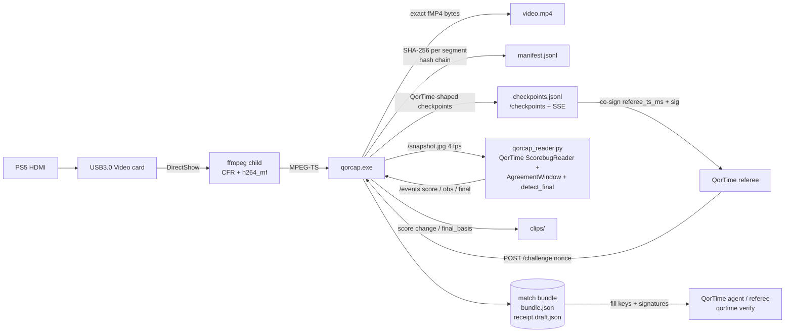

<p align="center"></p>

# QorCap

**Website:** https://conwan30.github.io/qorcap/ · **Download:** [v0.2.0](https://github.com/ConWan30/qorcap/releases/tag/v0.2.0)

A small Windows recorder for a USB HDMI capture card (built for a generic **"USB3.0 Video"** card carrying a PS5),
made for **[QorTime](https://github.com/ConWan30/qortime)** match receipts. It does two jobs:

1. **Keep recording when things go wrong.** If the card is unplugged, replugged, held by another app or the
   driver freezes, QorCap notices and reopens the device. A recorder that sits on a frozen device and never
   recovers is the problem this replaces.
2. **Produce evidence QorTime can use.** Every encoded video segment is hashed into a SHA-256 chain. It emits
   checkpoints in QorTime's format that a referee can co-sign, records when referee nonces arrive, runs
   QorTime's own scorebug reader inline, auto-saves clips, and writes a **match bundle** with a draft
   `qor-receipt/v0`.

> **What this proves, and what it does not.** A QorCap bundle shows the **integrity and timing** of the
> footage: which exact video bytes, in what order, seen when, and (once a referee co-signs the checkpoints)
> no later than the referee's clock. It does **not** show **who is holding the controller**, and it gives no
> cryptographic proof of player identity. Identity and liveness of the *player* are QorTime's job (player
> keys, the HID nonce response, dual-attested mode).

Design inspiration: [rec-rs](https://github.com/michaelshimeles/rec-rs) (a small, single-purpose recorder
with a local control surface). QorCap copies only that design idea, no code. No OBS code is used either.

## Quickstart: double-click Start Match

1. Download `qorcap-v0.2.0-windows-x64.zip` from the [release](https://github.com/ConWan30/qorcap/releases/tag/v0.2.0)
   and unzip it, for example to `C:\QorCap` (right-click the zip, *Extract All*).
2. Connect PS5 HDMI out to the **USB3.0 Video** card, and the card to a blue USB 3 port. Close OBS or the Camera app.
3. Double-click **`Start Match`**. On the first run it downloads ffmpeg, installs Python 3.12 through winget if it
   is missing, and sets up its Python packages in `%LOCALAPPDATA%\QorCap\venv`. This happens once.
4. Play. One window shows `[REC] time | AWAY x - HOME y  Qn m:ss | segments | signed | clips`.
5. Recording stops by itself when the final score is read (`final_basis`). You can also press **Enter** (or Q, or Ctrl+C).
6. It signs `receipt.json`, runs `qortime verify` and `qorcap verify-bundle`, prints **VERIFIED / PARTIAL / FAIL**,
   and opens the match folder (`Documents\QorCap Matches\match-YYYYMMDD-HHMMSS`).
7. To view it online, open https://conwan30.github.io/qortime/verify/, click *Choose file* and pick `receipt.json`
   (or paste its text), paste the contents of `referee.pub` into the key box, then click *Verify*. It runs in the browser and
   uploads nothing.

No card? Double-click **`Test Without Card`**. It plays a test-pattern video and a scripted 20-second game through the same
record, sign and verify path (`python sidecar/qorcap_match.py --test-pattern`).

**Trust level: self-attested.** No public QorTime referee server exists yet. So the launcher signs as the player with a
device key (QorTime `FileKey`, `%LOCALAPPDATA%\QorCap\keys\device.key`, ACL limited to your Windows user, never printed)
and countersigns every checkpoint live with a **local** referee key (`referee.key`, same protections). It uses QorTime's
own `checkpoints.countersign`, `receipt.build`, `sign_referee` and `sign_player`. The receipt's computed QorTime tier is
`single-attested` and `referee.key_kind` is `local-self-attested`, so anyone checking it can see the "referee" is the same PC.
With no referee challenges or HID motion, `qortime verify` gives **PARTIAL**: signatures, the checkpoint chain and the
video hashes are all checked, and challenges and motion are listed under "not checked". **FAIL** means something was altered or broken.
This proves the footage was not edited after it was recorded. It does not prove who was playing, and the PC's owner could
produce a self-attested receipt. An independent referee is needed for more than that.

Files in the match folder: `video.mp4`, `clips/`, `manifest.jsonl`, `checkpoints.jsonl`, `receipt.json` (signed),
`receipt.draft.json`, `referee.pub`, `verify.txt`, `qorcap.log`, `console.log`.

QorTime code: the zip bundles a pinned copy (`qortime/`, commit `f0d532a`). If it is missing, the launcher downloads that
pinned commit's zip once into `%LOCALAPPDATA%\QorCap`.

## Stack and why

**Rust (one ~1.6 MB `qorcap.exe`) controlling a separate `ffmpeg.exe`** (DirectShow input, Media Foundation
H.264 hardware encoder `h264_mf`, AAC).

- I chose this over a native `windows`-crate Media Foundation pipeline because MF capture plus encoding
  can't be tested from Linux. Writing it blind risked shipping something that doesn't work. ffmpeg's
  `dshow` + `h264_mf` path is proven on exactly this kind of card.
- Running ffmpeg as a **child process** is what makes recovery possible. A hung driver can only freeze
  ffmpeg, never QorCap. A watchdog kills the child after N seconds without data and starts a new one.
- The Rust side owns everything that needs to be reliable: the supervisor and backoff, the replay ring,
  recording rotation, the hash chain, checkpoints, the API and logging.

## Architecture

```
card --dshow--> ffmpeg (CFR fps filter, h264_mf, AAC) --MPEG-TS stdout--> qorcap
                       \--> snapshot.jpg (4 fps)                         |-- replay ring (RAM, keyframe-indexed TS)
                                                                         |-- ffmpeg remux --fMP4 stdout--> qorcap
                                                                         |        writes video.mp4 + SHA-256 per 2 s segment
                                                                         |-- checkpoints / challenges / events
                                                                         '-- HTTP API 127.0.0.1:8788 (+SSE)
```

- **Constant frame rate:** `fps=N` + `-fps_mode cfr`. When the card drops frames, the last frame is repeated.
  Extra frames are dropped. `dup_frames`/`drop_frames` appear in `/status`. `src/cfr.rs` holds the same rule
  as plain logic so it can be unit-tested.
- **Crash-safe:** fragmented MP4 (`empty_moov+frag_keyframe`, fragments ≥2 s), flushed as it is written. A
  power cut loses at most the last fragment.
- **Auto-reopen:** if ffmpeg exits, or no bytes arrive for `--watchdog` s (default 4), the device is reopened.
  If the device has disappeared, QorCap polls the device list every second until it comes back. Backoff is
  1→8 s. An active recording continues in `video.part2.mp4`, `part3`, … and the hash chain carries on across
  parts.
- **Replay buffer:** `--replay SECS` keeps MPEG-TS in RAM. Saved clips start with the cached PAT/PMT and a
  keyframe, then are remuxed to MP4.

## How QorCap fits QorTime



### Evidence details

| Piece | Format |
|---|---|
| Segment hash | `sha256` of the exact bytes on disk for segment *n* (seg 0 = `ftyp+moov`, then each `moof+mdat`, ~2 s) |
| Chain | `head_n = SHA-256(JCS({"prev": head_{n-1}, "seq": n, "sha256": seg_n}))`, `head_-1 = 64×"0"` |
| `manifest.jsonl` | `{type:"segment", seq, kind, file, offset, bytes, sha256, prev, chain_head, mono_ms, wall_ms, frames, device, device_id}`, plus `reopen` and `clip` rows |
| Checkpoint | QorTime body `{seq, t_ms, frames_hash, input_hash, prev, hash}` with `hash = SHA-256(JCS(body))`, the same rule as `qor_receipt/checkpoints.py`, chained from 64×"0". `frames_hash = SHA-256(JCS(qorcap))` commits to the attached `qorcap` evidence object: `{trigger, segment_seq, segment_hash, chain_head, score, mono_ms, match_id, role, [nonce], [final]}`. `input_hash = SHA-256(JCS([]))` because QorCap has no HID log. |
| Triggers | every segment, `score_change`, `clock_state` (clock hits 0:00 / red clock toggles), `challenge`, `final` |
| Challenge | `POST /challenge {nonce, phase, role, issued_ms, deadline_ms}` stores `pattern_for(nonce)` (a port of QorTime's, tested against Python output), `received_wall_ms`, `received_mono_ms`, `segment_seq_at_receipt`, `chain_head_at_receipt`, and a checkpoint that contains the nonce. With `--stamp`, the nonce and button pattern are **burned into the recorded video**, so footage after that point could not have been recorded before the nonce existed. |
| Scorebug | `sidecar/qorcap_reader.py` downscales to 640×360 and runs QorTime's **unchanged** `ScorebugReader`, `AgreementWindow` (≥3 agreeing frames over ≥400 ms), `PauseDetector` and `detect_final` (clock 0:00 Q4 with ≥3 reads / ≥5 for the red clock, `scorebug_gone`, `final_screen`). Left score = **away**, right = **home**. |
| Bundle | `video.mp4[.partN]`, `manifest.jsonl`, `checkpoints.jsonl`, `challenges.jsonl`, `timeline.jsonl`, `clips/`, `bundle.json`, `receipt.draft.json`, `qorcap.log` |

`qorcap verify-bundle DIR` re-reads every segment from disk, recomputes the chain and every checkpoint, and
reports any changed byte, gap, truncation or broken link.

`receipt.draft.json` is a **draft and unsigned**. It is filled with what QorCap observed (match, result with
`final_basis`, challenges with `result: null`, `single-attested`). Player and referee keys are all-zero
placeholders, and `checkpoints` and `signatures` are empty. It will **FAIL** `qortime verify` until the
QorTime agent/referee fills in keys, co-signed checkpoints, challenge verdicts and signatures. QorTime
currently has no `qortime sign` command. Signing happens in its agent/referee flow.

## Commands

```
qorcap devices
qorcap record --device "USB3.0 Video" --res 1280x720 --fps 30 --out file.mp4 [--duration N] [--replay SECS]
       [--audio auto|none|"<name>"] [--encoder h264_mf|libx264|h264_nvenc|h264_qsv|h264_amf] [--bitrate 8M]
       [--input-format auto|mjpeg|yuyv422|nv12] [--watchdog 4]
       [--bundle DIR --match-id ID --role home|away --player-id psn:you --clip-secs 20 --stamp]
qorcap save-replay [--out clip.mp4]
qorcap status
qorcap stop
qorcap verify-bundle DIR
```
Global: `--port 8788`, `--ffmpeg PATH`, `--log FILE` (default `qorcap.log`, or `DIR\qorcap.log` with `--bundle`).
`--bundle` turns on `--out DIR\video.mp4` and `--replay 90` by default.

## Control API (127.0.0.1 only)

| Method | Path | |
|---|---|---|
| GET | `/status` | state (`capturing`/`waiting_for_device`/`reopening`), fps, frames, dup/drop, reopen_count, last_error, recording, replay buffer |
| POST | `/record/start` `{out?, duration?}` · `/record/stop` | |
| POST | `/replay/save` `{out?}` | returns `{file}` |
| GET | `/snapshot.jpg` | latest frame (4 fps) |
| POST | `/challenge` | referee nonce |
| POST | `/events` | `{type:"score",home,away,quarter,clock_s,clock_red}` · `{type:"obs",obs,t_ms,until_ms,n}` · `{type:"final",basis,home,away,quarter}` |
| GET | `/checkpoints?since=N` · `/checkpoints/stream` (SSE) · `/timeline` | |
| POST | `/bundle/write` · `/shutdown` | |

## Run on Windows by hand (PowerShell, advanced)

```powershell
# 1. unzip qorcap-v0.2.0-windows-x64.zip to C:\QorCap, then:
cd C:\QorCap
Unblock-File .\qorcap.exe, .\get-ffmpeg.ps1
powershell -ExecutionPolicy Bypass -File .\get-ffmpeg.ps1     # puts ffmpeg.exe next to qorcap.exe
.\qorcap.exe devices                                          # expect "USB3.0 Video" (+ its audio device)
# 2. plain recording
.\qorcap.exe record --device "USB3.0 Video" --res 1280x720 --fps 30 --out C:\QorCap\test.mp4 --duration 60
# 3. QorTime match: bundle + replay + nonce stamp
.\qorcap.exe record --device "USB3.0 Video" --res 1280x720 --fps 30 --bundle C:\QorCap\match1 --match-id <id> --role home --player-id psn:<you> --stamp
# 4. second PowerShell window: scorebug sidecar (needs Python 3.11+ and a qortime checkout)
py -m pip install numpy opencv-python-headless cryptography
py .\sidecar\qorcap_reader.py --qortime C:\src\qortime
# 5. control
.\qorcap.exe status
.\qorcap.exe save-replay
Invoke-RestMethod -Method Post http://127.0.0.1:8788/challenge -Body '{"nonce":"00112233445566778899aabbccddeeff","phase":"kickoff"}'
.\qorcap.exe stop
.\qorcap.exe verify-bundle C:\QorCap\match1
```
If `h264_mf` fails on this laptop, use `--encoder libx264` (CPU). If the card refuses 1280x720 raw, try
`--input-format mjpeg`. Errors go to the log with a cause, for example "device busy/shared by another app,
or unplugged" or "video device "USB3.0 Video" not present (have: …)".

## Tested vs untested

Tested on Linux (`cargo test`: 22 Rust tests; `pytest sidecar`: 11 tests, including the full `--test-pattern` launcher run end to end: record, live countersign, final, sign, `qortime verify` PARTIAL with no errors, `verify-bundle` OK, receipt valid against QorTime's JSON schema and accepted by the browser verifier's `verify.js`):
CLI parsing; replay ring (window/byte cap, keyframe start, PAT/PMT, last-N seconds); CFR pacing; dshow
device-list parsing (old and new ffmpeg formats) and card-audio auto-pick; ffmpeg argument building; JCS
against QorTime's `jcs_vector.json`; checkpoint hash against Python `make_checkpoint`; `pattern_for` against
Python; fMP4 segment splitter; tamper detection; draft receipt shape; every API route including SSE; the
sidecar's left=away mapping, the 5-read red clock rule, the `scorebug_gone` fallback, ties not counting as
final, and QorTime's real reader on a QorTime Madden fixture after 720p→360p scaling. End to end on Linux
with `--device testpattern` (ffmpeg lavfi): recording, killing ffmpeg mid-run (reopen into `part2`, chain
continues), replay save, challenge stamp visible in the video, score/final events, auto clips, bundle
written, `verify-bundle` OK, and a single flipped byte reported as FAIL.

**Not tested:** `Start Match.cmd` / `start-match.ps1` on Windows (prerequisite checks, winget, venv, icacls key ACL, the Enter-key stop with msvcrt, opening the folder), the real USB3.0 card, DirectShow, `h264_mf`, real unplug/replug on Windows, card audio, the
Windows `drawtext` font path (`C:\Windows\Fonts\consola.ttf`), and the sidecar on real live PS5 frames.
The `.exe` was cross-compiled but has not been run on Windows.

## Stubbed / not done
- `receipt.draft.json` stays unsigned (see above). `Start Match` writes the signed, self-attested `receipt.json`. Signing by an independent referee needs a QorTime referee server, which does not exist yet.
- A device outage longer than 10 s leaves a checkpoint gap, and `qortime verify` then reports `gap_too_long` (FAIL). This is the intended behaviour: the gap is real.
- No `final_screen` detector (QorTime doesn't ship one yet). The hook is wired.
- No HID input in QorCap, so `input_hash` is the hash of an empty list.
- No PR to qortime yet for ingesting bundles.

## Build
```
cargo test
cargo build --release --target x86_64-pc-windows-gnu   # linker: x86_64-w64-mingw32-gcc (.cargo/config.toml)
```
License: MIT. ffmpeg is downloaded separately and keeps its own license.
