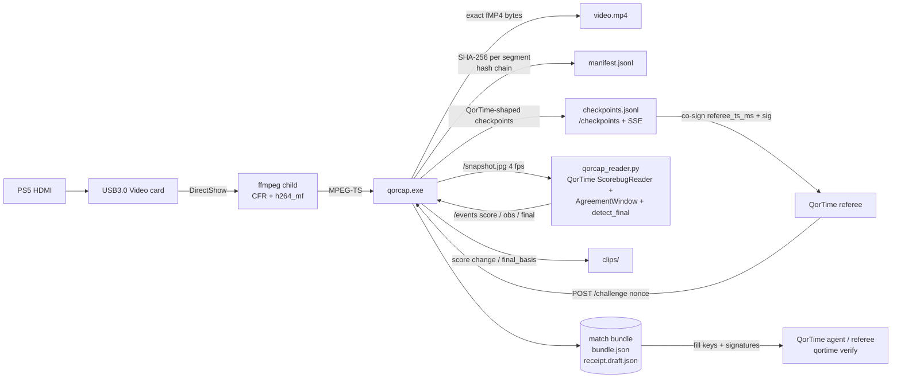

<p align="center"></p>

# QorCap

**Website:** https://conwan30.github.io/qorcap/ · **Download:** [v0.3.13](https://github.com/ConWan30/qorcap/releases/tag/v0.3.13) ([latest release](https://github.com/ConWan30/qorcap/releases/latest))

A small Windows recorder for a USB HDMI capture card (built for a generic **"USB3.0 Video"** card carrying a PS5),
made for **[QorTime](https://github.com/ConWan30/qortime)** match receipts. It does two jobs:

1. **Keep recording when things go wrong.** If the card is unplugged, replugged, held by another app or the
   driver freezes, QorCap notices and reopens the device. A recorder that sits on a frozen device and never
   recovers is the problem this replaces.
2. **Produce evidence QorTime can use.** Every encoded video segment is hashed into a SHA-256 chain. It emits
   checkpoints in QorTime's format that a referee can co-sign, records when referee nonces arrive, runs
   QorTime's own scorebug reader inline, auto-saves clips, and writes a **match bundle** with a draft
   `qor-receipt/v0`.

> **What this proves, and what it does not.** A QorCap bundle shows the **integrity and timing** of the
> footage: which exact video bytes, in what order, seen when, and (once a referee co-signs the checkpoints)
> no later than the referee's clock. It does **not** show **who is holding the controller**, and it gives no
> cryptographic proof of player identity. Identity and liveness of the *player* are QorTime's job (player
> keys, the HID nonce response, dual-attested mode).

Design inspiration: [rec-rs](https://github.com/michaelshimeles/rec-rs) (a small, single-purpose recorder
with a local control surface). QorCap copies only that design idea, no code. No OBS code is used either.

## Quickstart: double-click Start Match

1. Download `qorcap-v0.3.13-windows-x64.zip` from the [latest release](https://github.com/ConWan30/qorcap/releases/latest)
   and unzip it, for example to `C:\QorCap` (right-click the zip, *Extract All*).
2. Connect PS5 HDMI out to the **USB3.0 Video** card, and the card to a blue USB 3 port. Close OBS or the Camera app.
3. Double-click **`Start Match`**. On the first run it downloads ffmpeg, installs Python 3.12 through winget if it
   is missing, and sets up its Python packages in `%LOCALAPPDATA%\QorCap\venv`. This happens once.
4. Play. One window shows `[REC] time | AWAY x - HOME y  Qn m:ss | segments | signed | clips`.
5. Recording stops by itself when the final score is read from Madden's **end-of-game menu** (authoritative; a scorebug-only final waits up to 120 s for that menu). You can also press **Enter** (or Q, or Ctrl+C).
6. It signs `receipt.json`, runs `qortime verify` and `qorcap verify-bundle`, prints **VERIFIED / PARTIAL / FAIL**,
   and opens the match folder (`Documents\QorCap Matches\match-YYYYMMDD-HHMMSS`).
7. To view it online, open https://conwan30.github.io/qortime/verify/, click *Choose file* and pick `receipt.json`
   (or paste its text), paste the contents of `referee.pub` into the key box, then click *Verify*. It runs in the browser and
   uploads nothing.

Start Match records with the settings that worked on the first real test (laptop MyTurn, **USB3.0 Video** card):
`--input-format mjpeg`, 1280x720, 30 fps, `h264_mf` (29.7 fps measured). That card lists raw `yuyv422` only at 1920x1080
and up, so for `--input-format auto` QorCap now runs `-list_options` and picks mjpeg when the requested size is not
offered raw. Card audio is its own DirectShow audio device (`Digital Audio Interface (USB3.0 Audio)`), so it is
opened as a second `-f dshow -i audio=...` input. Both inputs are wall-clock stamped and audio goes through
`aresample=async`. If the audio device cannot be opened, QorCap logs a warning and records **video-only**, so it does not
keep reopening. If OBS (`obs64.exe`) is running, you get **"Close OBS. It's using the capture card"** and Start Match
offers to close it for you. A failure is only reported as "busy" when ffmpeg says the device is busy or in use.

**Finalize after the fact (offline).** If the live score reader missed the game, or you recorded with `qorcap record --bundle`,
double-click **`Finalize Last Match`** (or run `qorcap finalize <bundle folder>`). It decodes `video.mp4` at 4 fps,
runs the same QorTime `ScorebugReader` + `AgreementWindow` + `detect_final`, and writes `timeline.offline.jsonl`,
`score_checkpoints.jsonl` (a QorTime-shaped hash chain over the score changes and the final, each bound to the video
chain head) and `final.offline.json`. Then it signs `receipt.json` the same way Start Match does. If Start Match
countersigned live (`countersigned.jsonl`), those signatures are reused. Otherwise the local referee countersigns QorCap's
checkpoints at finalize time, stamping each with QorCap's recording time, and `referee.key_kind` is
`local-self-attested-offline` so a reader can tell.

No card? Double-click **`Test Without Card`**. It plays a test-pattern video and a scripted 20-second game through the same
record, sign and verify path (`python sidecar/qorcap_match.py --test-pattern`).

**Trust level: self-attested.** No public QorTime referee server exists yet. So the launcher signs as the player with a
device key (QorTime `FileKey`, `%LOCALAPPDATA%\QorCap\keys\device.key`, ACL limited to your Windows user, never printed)
and countersigns every checkpoint live with a **local** referee key (`referee.key`, same protections). It uses QorTime's
own `checkpoints.countersign`, `receipt.build`, `sign_referee` and `sign_player`. The receipt's computed QorTime tier is
`single-attested` and `referee.key_kind` is `local-self-attested`, so anyone checking it can see the "referee" is the same PC.
With no referee challenges or HID motion, `qortime verify` gives **PARTIAL**: signatures, the checkpoint chain and the
video hashes are all checked, and challenges and motion are listed under "not checked". **FAIL** means something was altered or broken.
This proves the footage was not edited after it was recorded. It does not prove who was playing, and the PC's owner could
produce a self-attested receipt. An independent referee is needed for more than that.

Files in the match folder: `video.mp4`, `clips/`, `manifest.jsonl`, `checkpoints.jsonl`, `receipt.json` (signed),
`receipt.draft.json`, `referee.pub`, `verify.txt`, `qorcap.log`, `console.log`, `countersigned.jsonl` (live
referee countersignatures); after finalize also `timeline.offline.jsonl`, `score_checkpoints.jsonl`, `final.offline.json`; when the final was
confirmed from the recording's last minutes at stop, `final.tail.json` and `clips/final-recorded.mp4`.

QorTime code: the zip bundles a pinned copy (`qortime/`, commit `e9c5c95`, includes `qortime referee-ai`, `end_menu_read` and official-review (verified uploads) support). If it is missing, the launcher downloads that
pinned commit's zip once into `%LOCALAPPDATA%\QorCap`.

## Stack and why

**Rust (one ~1.6 MB `qorcap.exe`) controlling a separate `ffmpeg.exe`** (DirectShow input, Media Foundation
H.264 hardware encoder `h264_mf`, AAC).

- I chose this over a native `windows`-crate Media Foundation pipeline because MF capture plus encoding
  can't be tested from Linux. Writing it blind risked shipping something that doesn't work. ffmpeg's
  `dshow` + `h264_mf` path is proven on exactly this kind of card.
- Running ffmpeg as a **child process** is what makes recovery possible. A hung driver can only freeze
  ffmpeg, never QorCap. A watchdog kills the child after N seconds without data and starts a new one.
- The Rust side owns everything that needs to be reliable: the supervisor and backoff, the replay ring,
  recording rotation, the hash chain, checkpoints, the API and logging.

## Architecture

```
card --dshow--> ffmpeg (CFR fps filter, h264_mf, AAC) --MPEG-TS stdout--> qorcap
                       \--> snapshot.jpg (4 fps)                         |-- replay ring (RAM, keyframe-indexed TS)
                                                                         |-- ffmpeg remux --fMP4 stdout--> qorcap
                                                                         |        writes video.mp4 + SHA-256 per 2 s segment
                                                                         |-- checkpoints / challenges / events
                                                                         '-- HTTP API 127.0.0.1:8788 (+SSE)
```

- **Constant frame rate:** `fps=N` + `-fps_mode cfr`. When the card drops frames, the last frame is repeated.
  Extra frames are dropped. `dup_frames`/`drop_frames` appear in `/status`. `src/cfr.rs` holds the same rule
  as plain logic so it can be unit-tested.
- **Crash-safe:** fragmented MP4 (`empty_moov+frag_keyframe`, fragments ≥2 s), flushed as it is written. A
  power cut loses at most the last fragment.
- **Auto-reopen:** if ffmpeg exits, or no bytes arrive for `--watchdog` s (default 4), the device is reopened.
  If the device has disappeared, QorCap polls the device list every second until it comes back. Backoff is
  1→8 s. An active recording continues in a **new** `video.partN.mp4` (never truncates an existing part that
  already has content). The hash chain carries on across parts. Free space is checked before start and while
  recording; critically low disk stops cleanly (`disk_full`) instead of writing into ENOSPC.
- **Replay buffer:** `--replay SECS` keeps MPEG-TS in RAM. Saved clips start with the cached PAT/PMT and a
  keyframe, then are remuxed to MP4.

## How QorCap fits QorTime



### Evidence details

| Piece | Format |
|---|---|
| Segment hash | `sha256` of the exact bytes on disk for segment *n* (seg 0 = `ftyp+moov`, then each `moof+mdat`, ~2 s) |
| Chain | `head_n = SHA-256(JCS({"prev": head_{n-1}, "seq": n, "sha256": seg_n}))`, `head_-1 = 64×"0"` |
| `manifest.jsonl` | `{type:"segment", seq, kind, file, offset, bytes, sha256, prev, chain_head, mono_ms, wall_ms, frames, device, device_id}`, plus `reopen` and `clip` rows |
| Checkpoint | QorTime body `{seq, t_ms, frames_hash, input_hash, prev, hash}` with `hash = SHA-256(JCS(body))`, the same rule as `qor_receipt/checkpoints.py`, chained from 64×"0". `frames_hash = SHA-256(JCS(qorcap))` commits to the attached `qorcap` evidence object: `{trigger, segment_seq, segment_hash, chain_head, score, mono_ms, match_id, role, [nonce], [final]}`. `input_hash = SHA-256(JCS([]))` because QorCap has no HID log. |
| Triggers | every segment, `score_change`, `clock_state` (clock hits 0:00 / red clock toggles), `challenge`, `final` |
| Challenge | `POST /challenge {nonce, phase, role, issued_ms, deadline_ms}` stores `pattern_for(nonce)` (a port of QorTime's, tested against Python output), `received_wall_ms`, `received_mono_ms`, `segment_seq_at_receipt`, `chain_head_at_receipt`, and a checkpoint that contains the nonce. With `--stamp`, the nonce and button pattern are **burned into the recorded video**, so footage after that point could not have been recorded before the nonce existed. |
| Scorebug | `sidecar/qorcap_reader.py` downscales to 640×360 and runs QorTime's **unchanged** `ScorebugReader`, `AgreementWindow` (≥3 agreeing frames over ≥400 ms), `PauseDetector` and `detect_final` (clock 0:00 Q4 with ≥3 reads / ≥5 for the red clock, `scorebug_gone`, `final_screen`). Left score = **away**, right = **home**. |
| Bundle | `video.mp4[.partN]`, `manifest.jsonl`, `checkpoints.jsonl`, `challenges.jsonl`, `timeline.jsonl`, `clips/`, `bundle.json`, `receipt.draft.json`, `qorcap.log` |

`qorcap verify-bundle DIR` re-reads every segment from disk, recomputes the chain and every checkpoint, and
reports any changed byte, gap, truncation or broken link.

`receipt.draft.json` is a **draft and unsigned**. It is filled with what QorCap observed (match, result with
`final_basis`, challenges with `result: null`, `single-attested`). Player and referee keys are all-zero
placeholders, and `checkpoints` and `signatures` are empty. It will **FAIL** `qortime verify` until the
QorTime agent/referee fills in keys, co-signed checkpoints, challenge verdicts and signatures. QorTime
currently has no `qortime sign` command. Signing happens in its agent/referee flow.

## Controller input proof (v0.3.0)

Setup this is built for: the DualSense / DualSense Edge plays the PS5 over **Bluetooth** while the same pad is
**USB-plugged into the laptop**, so the laptop reads its HID reports. Both links at once is intended.

* **Self-test:** double-click **Input Test.cmd** (or `qorcap input-test [--secs 30]`). It prints `[ OK ] HID is being
  read: DualSense Edge (USB)`, the report rate, each press (`PRESS CROSS`), triggers and sticks live, then a summary.
  If the pad is not visible over USB it says so plainly and exits with code 1.
* **During a match** (`record`, Start Match): QorCap reads the pad on a background thread and stamps every report
  with `t_us` from the **same monotonic clock** as the `mono_ms` of the 2-second video segments. Each time a
  segment is hashed, the inputs received so far are sealed into a chunk: `input_hash = SHA-256(JCS([records]))`
  goes into that segment's checkpoint (so it is part of the checkpoint hash chain), and chunks are chained like
  the video (`head_n = SHA-256(JCS({prev, seq, sha256}))`). Records go to `inputs.jsonl` in the bundle.
  Buttons are always logged; analog-only changes at most every 4 ms.
* **Missing / unplugged controller:** recording never stops. A `WARN CONTROLLER: ...` line is logged, `/status`
  shows `input.state` = `missing` / `unplugged` / `stalled` with a warning, and the state change is itself a
  record in `inputs.jsonl` (absence is committed, not hidden). `--no-controller` turns logging off.
* **At bundle write** (and `qorcap input-proof DIR`): `input_proof.json` (schema `qorcap-input-proof/v0`) with
  * `human`: human-likeness 50..950 permille (never 0 or 1000), label, confidence (`none`/`low`/`medium`, never
    high) and reasons, from press-timing jitter, hold-duration jitter, stick ramps, stick micro-drift and
    trigger pressure ramps. Metronomic turbo/macro patterns score low. It is a heuristic and says so.
  * `alignment` (v2, 0.3.2): one decode pass of the whole video at 96x54 gray (2-frame motion energy). The
    video clock comes from a least-squares fit of every media segment's (`mono_ms`, `frames`), not the init
    segment (which lands seconds after frame 0 on a real card). A key press is scored only when the screen was
    still for the 20 frames before it (play-call, pre-snap, menus): it matches if motion energy jumps to >= 5x
    that baseline within 100-667 ms. The residual offset is searched in +/-3 s on half the presses and scored on
    the other half (2-fold), so `match_permille` is never measured at an offset fitted to the same presses.
    `chance_permille` = the same presses shifted 3-8 s (>= 700 ms from any press) through the same filter and
    offsets. Also `z_x100` (two-proportion z x100), `offset_ms`/`offset_iqr_ms` (press -> onset, includes
    capture + game latency), `calibration_offsets_ms`, `presses_spaced`/`presses_tested`, and scorebug score
    events with controller activity in the 30 s before. Mid-play presses (camera already moving) are not scored.
  * `inputs_sha256`, `inputs_chain_head`, warnings, and the limit.
* **Receipt (backward-compatible):** `receipt.draft.json` gains `signals.input` = `{status, device,
  human_permille, human_label, match_permille, chance_permille, offset_ms, inputs_sha256, inputs_chain_head,
  claims}` (integers only, inside QorTime's JCS profile; `signals` allows extra keys in `receipt.v0.json`).
  `bundle.json` gains the same block as `input`. Older readers ignore both. Bundles with no controller keep the
  pre-0.3.0 `input_hash` (= hash of `[]`).
* **`verify-bundle`** re-hashes `inputs.jsonl` chunks and checks each against its checkpoint's `input_hash`.

**Limit, plainly:** this shows the inputs came from the controller plugged into this laptop, in sync with this
video. It does **not** show who was holding the controller.

For `qortime referee-ai`: read `input_proof.json` (or `bundle.json.input`). Treat `status != "ok"` as "no input
evidence", compare `match_permille` against `chance_permille` rather than reading it alone, and treat
`human.score_permille` as a soft signal with its reasons.

## Haptic detection from the IMU (v0.3.1)

The PS5's rumble commands go over Bluetooth, so the laptop cannot see them; instead QorCap watches the pad's
gyro + accelerometer in the USB reports for vibration bursts (20 Hz high-pass, adaptive threshold, 3 s still
calibration). Events go into `inputs.jsonl` (committed by `input_hash`), a copy into `haptics.jsonl`, and a
summary into `input_proof.json` `haptics`. Input Test shows `HAPTIC peak=.. dur=..ms` lines and
`[ OK ] IMU readable`. **Advisory corroborating evidence only.** See [docs/HAPTICS.md](docs/HAPTICS.md).

## Submit for Verification (v0.3.9)

A bundle signed only by your laptop is **SELF_ATTESTED**. To get **VERIFIED**, submit it to the QorTime official
referee (`https://qortime-referee-production.up.railway.app`): double-click **Submit for Verification**, answer `y` at
the end of Start Match, or run `qorcap submit "<bundle dir>"` (`--full` uploads every segment; `--yes` skips the prompt).

1. QorCap uploads the small metadata (manifest, checkpoints, inputs, receipts, no video).
2. The referee re-checks every chain and signature on its own, *then* picks which video segments it wants:
   the init segment, the last 240 s, the segments around each challenge, and 16 random ones (about 150-300 MB).
3. QorCap uploads those; the referee hashes the bytes against the manifest chain, re-reads the final score with
   QorCap's own readers, re-checks pause/motion/input evidence and the official challenges.
4. Only if every check passes does it countersign with the official key. You get `receipt.official.json` and
   `verify.official.txt` in the bundle.

During a match QorCap stamps the chain head with the referee every 60 s (turn off with `--no-anchors`). For
**VERIFIED:** Start Match passes `--official-challenges` unless you add `--no-official-challenges`. The
referee then issues three timed challenges (game start, second half, Q4) that you answer on the pad. Without them the
best result is **PARTIAL**: the
referee can prove the bytes are what you recorded, not that they were recorded live. Spot-check mode is a sampled
check: a doctored region of fraction f slips through with probability about (1-f)^16 plus the tail and challenge
segments. Details: QorTime `docs/REFEREE_SERVICE.md`.

### Official challenges: only when you can pause (v0.3.11)

Online Madden 27 does not let you pause during a kickoff or a kickoff return. OPTIONS only works once a play has been
called. Up to v0.3.10 the "kickoff" challenge appeared about 10 seconds into the recording, before the kickoff, with
20 seconds to answer. It could not be passed. The halftime and Q4 challenges were tied to the first Q3/Q4 scorebug read,
which is the second-half kickoff itself (and on Sunday/Thursday Night presentations no quarter was read at all).

From v0.3.11:

- **What you see:** nothing at kickoff. After the kickoff of each half (and in Q4), once the game clock has started
  and a play-call screen has come and gone, QorCap beeps and prints
  `>>> QORTIME CHALLENGE (game start): at the line, before the snap, press OPTIONS, then CROSS UP LEFT SQUARE, then resume. You have 90 seconds ... <<<`.
- **What you do:** at the line before the snap, press OPTIONS (the pause menu opens), press the four buttons, resume.
  If your opponent snaps first, do it at the next play. A dead OPTIONS press during a live play doesn't void it.
- **Still checked:** the pattern is only known after the referee issues it, every press must be inside the window,
  and the pause menu must appear on the video 0–600 ms after the OPTIONS press that starts the pattern. There are
  still exactly 3 challenges (Q1–Q2, Q3, Q4/OT), one window open at a time. If no play-call screen is detected, the
  window opens 45 s after the clock starts running in that quarter. Every opening is logged in `challenge_gates.jsonl`.
- **Receipt fix:** at the end QorCap re-runs each challenge on its own video and controller log (QorTime's rules).
  Answered challenges are written into the receipt as passed. Up to v0.3.10 they always stayed empty
  (`challenge_unanswered`). Misses stay empty and the reason is in `challenge_results.jsonl`.

### Signed submissions (v0.3.10)

From v0.3.10 every submission is signed by this PC's **install key**. That is the same Ed25519 device key that
recorded the match, stored in the QorCap data folder as `keys/device.key`. You don't need an account.

How a submission works:

1. QorCap asks the referee for a single-use nonce.
2. It solves a small proof-of-work, which takes about a second.
3. It signs the timestamp, the nonce, the zip hash and the bundle's manifest hash.

What the referee enforces:

- It rejects replayed requests.
- It rate-limits each install key (new keys get a low quota) and caps the total number of submissions.
- It accepts the submission only when the signing key is the bundle's recorder key.

**v0.3.9 and older can no longer submit.** They get `HTTP 426: QorCap 0.3.10 or newer is required`.

The referee now signs with a short-lived online key that the offline QorTime root key `qortime-v1` delegates to.
QorCap checks that delegation locally before uploading. Each countersigned receipt is also added to the referee's
public transparency log, and QorCap prints the entry number. See QorTime `docs/REFEREE_KEYS.md`.

v0.3.10 also includes the v0.3.9 crash fix: Start Match and Finalize no longer exit with code 6 on a SELF_ATTESTED
verdict (#14).

## Commands

```
qorcap devices
qorcap record --device "USB3.0 Video" --res 1280x720 --fps 30 --out file.mp4 [--duration N] [--replay SECS]
       [--audio auto|none|"<name>"] [--encoder h264_mf|libx264|h264_nvenc|h264_qsv|h264_amf] [--bitrate 8M]
       [--input-format auto|mjpeg|yuyv422|nv12] [--watchdog 4]
       [--bundle DIR --match-id ID --role home|away --player-id psn:you --clip-secs 20 --stamp]
       [--min-free-gb 2]
qorcap save-replay [--out clip.mp4]
qorcap status
qorcap stop
qorcap verify-bundle DIR
qorcap input-test [--secs N]
qorcap input-proof DIR [--frames 15] [--no-video]
qorcap submit DIR [--full] [--referee URL] [--yes]
qorcap record ... [--no-controller]
```
Global: `--port 8788`, `--ffmpeg PATH`, `--log FILE` (default `qorcap.log`, or `DIR\qorcap.log` with `--bundle`).
`--bundle` turns on `--out DIR\video.mp4` and `--replay 90` by default.

## Control API (127.0.0.1 only)

| Method | Path | |
|---|---|---|
| GET | `/status` | state (`capturing`/`waiting_for_device`/`reopening`), fps, frames, dup/drop, reopen_count, last_error, recording, replay buffer |
| POST | `/record/start` `{out?, duration?}` · `/record/stop` | |
| POST | `/replay/save` `{out?}` | returns `{file}` |
| GET | `/snapshot.jpg` | latest frame (4 fps) |
| POST | `/challenge` | referee nonce |
| POST | `/events` | `{type:"score",home,away,quarter,clock_s,clock_red}` · `{type:"obs",obs,t_ms,until_ms,n}` · `{type:"final",basis,home,away,quarter}` |
| GET | `/checkpoints?since=N` · `/checkpoints/stream` (SSE) · `/timeline` | |
| POST | `/bundle/write` · `/shutdown` | |

## Run on Windows by hand (PowerShell, advanced)

```powershell
# 1. unzip qorcap-v0.3.13-windows-x64.zip to C:\QorCap, then:
cd C:\QorCap
Unblock-File .\qorcap.exe, .\get-ffmpeg.ps1
powershell -ExecutionPolicy Bypass -File .\get-ffmpeg.ps1     # puts ffmpeg.exe next to qorcap.exe
.\qorcap.exe devices                                          # expect "USB3.0 Video" (+ its audio device)
# 2. plain recording
.\qorcap.exe record --device "USB3.0 Video" --res 1280x720 --fps 30 --out C:\QorCap\test.mp4 --duration 60
# 3. QorTime match: bundle + replay + nonce stamp
.\qorcap.exe record --device "USB3.0 Video" --res 1280x720 --fps 30 --bundle C:\QorCap\match1 --match-id <id> --role home --player-id psn:<you> --stamp
# 4. second PowerShell window: scorebug sidecar (needs Python 3.11+ and a qortime checkout)
py -m pip install numpy opencv-python-headless cryptography
py .\sidecar\qorcap_reader.py --qortime C:\src\qortime
# 5. control
.\qorcap.exe status
.\qorcap.exe save-replay
Invoke-RestMethod -Method Post http://127.0.0.1:8788/challenge -Body '{"nonce":"00112233445566778899aabbccddeeff","phase":"kickoff"}'
.\qorcap.exe stop
.\qorcap.exe verify-bundle C:\QorCap\match1
```
If `h264_mf` fails on this laptop, use `--encoder libx264` (CPU). If the card refuses 1280x720 raw, try
`--input-format mjpeg`. Errors go to the log with a cause, for example "device busy/shared by another app,
or unplugged" or "video device "USB3.0 Video" not present (have: …)".

## Tested vs untested

Tested on Linux (`cargo test`: 29 Rust tests; `pytest sidecar`: 14 passed / 3 skipped without cv2/jsonschema, including offline `finalize` on test-pattern bundles (scripted scorebug → clock_zero final, score checkpoint chain, receipt verifies; real QorTime reader through `qorcap finalize`; reuse of live countersignatures), including the full `--test-pattern` launcher run end to end: record, live countersign, final, sign, `qortime verify` PARTIAL with no errors, `verify-bundle` OK, receipt valid against QorTime's JSON schema and accepted by the browser verifier's `verify.js`):
CLI parsing; replay ring (window/byte cap, keyframe start, PAT/PMT, last-N seconds); CFR pacing; dshow
device-list parsing (old and new ffmpeg formats) and card-audio auto-pick; `-list_options` parsing and auto→mjpeg choice; ffmpeg failure classification (audio-open vs busy vs format); ffmpeg argument building; JCS
against QorTime's `jcs_vector.json`; checkpoint hash against Python `make_checkpoint`; `pattern_for` against
Python; fMP4 segment splitter; tamper detection; draft receipt shape; every API route including SSE; the
sidecar's left=away mapping, the 5-read red clock rule, the `scorebug_gone` fallback, ties not counting as
final, and QorTime's real reader on a QorTime Madden fixture after 720p→360p scaling. End to end on Linux
with `--device testpattern` (ffmpeg lavfi): recording, killing ffmpeg mid-run (reopen into `part2`, chain
continues), replay save, challenge stamp visible in the video, score/final events, auto clips, bundle
written, `verify-bundle` OK, and a single flipped byte reported as FAIL.

**Tested on Windows (v0.2.0–v0.2.1 era, MyTurn, USB3.0 Video):** `--input-format mjpeg` 1280x720@30 with `h264_mf` at 29.7 fps. v0.2.1 fixed audio / auto-format / OBS.

**v0.3.13:** the Thursday Night end screen confirms 10–16 OT when the last score lock has no quarter (that lock no longer erases the OT read, and a rejected end-menu candidate is logged). A quarter glyph is emitted only when its own template wins by a clear margin — a fused ordinal is not labeled as another quarter — and a quarter never goes backwards. The receipt quarter comes from that confirmed final, or from the last read that had one.

**v0.3.12 (Thursday Night match-20261017-091651, SEA 10 – DEN 16 OT):** a failed quarter glyph no longer blocks the score and the clock (a lock is still 3 agreeing per-digit reads). Real quarter templates for 1ST, 3RD, 4TH (including the red final minute) and OT from that match; no 2ND crop, and no score 5/8/9 (Sunday Night's 5 and 9 are synthetic and were not copied). The Thursday Night end screen (stadium behind FINISH GAME, OT, 10–16) is recognised, and Start Match passes `--official-challenges` unless `--no-official-challenges` is set.

**v0.3.8:** Start Match auto-wires live haptics / input activity / score-change clip hashes into `ReaderCore.delta_corroboration` (and the stop-time tail fallback), so a one-legal-step end-menu final can be confirmed live with the same rules as offline. Rust `write_bundle` honors sidecar `final_confirmed` + `delta_corroboration`.

**v0.3.7:** End-menu one-legal-step deltas need corroboration (`final_confirmed`); QorTime pin includes trusted-referee allowlist + challenge evidence re-validation + `input_advisory`. Local QorCap referee stays SELF_ATTESTED.

**v0.3.6:** (1) **Game-audio level checks**: Start Match records 4 s of the card's audio before the match
(`audio_precheck.json`), and Start Match/Finalize measure the recorded audio (`audio_check.json`); a silent card
(max <= -70 dB) prints a loud warning with the fixes (PS5 Audio Output / 'Output to Headphones' = Chat Audio, Windows
input level). match-20261016-170000's card audio was digital silence (-90 dB) although the capture worked, and the two
earlier matches recorded no audio track at all. (2) **Covered end-of-game menu**: on online matches the name tags
cover the top of the away score; the panel can now **corroborate** (never read) the scorebug's Q4 final: the lower
part of the digits must match the scorebug value clearly better (margin >= 0.15) than every one-legal-play alternative,
on both sides, on 3 consecutive frames; then `end_menu_read` / `final_confirmed` with a note. (3) `input-proof` uses
Finalize's `timeline.offline.jsonl` for score-change checks when the live timeline has no score reads
(`score_source`). (4) The end-of-recording `gap_too_long`/`clock_skew` failures were v0.3.2 recordings; v0.3.5's
recorder seals and countersigns the tail within ~150 ms (verified on MyTurn, verify errors: none).

**v0.3.5 (Monday Night primetime scorebug, `madden27_monday_night`):** match-20261016-170000 (HOU at CHI/"QOR",
online H2H) used Madden's **Monday Night** presentation, whose scorebug is a different overlay (orange `MNP` wordmark,
`--- HOU 34 < 29 QOR ---`, then `4TH 0:00 [:39]`). QorTime's `madden27_standard` reader answered `layout_unknown` on
every frame, so the live timeline was one `scorebug_absent` span and the draft said 0-0. `sidecar/qorcap_mnp.py` adds a
Monday Night reader (same method as QorTime's: glyph components, `norm_vec` templates, best/margin gate, fail closed;
pack `sidecar/packs/madden27_monday_night_v1.npz` built from that match's real frames by
`tools/make_monday_night_pack.py` + `tools/monday_night_labels.json`; score digit 5 is synthetic from the clock font,
everything else real) and `AutoProfileReader`: QorTime's standard reader first, unchanged; the Monday Night profile only
when the standard layout is not on screen; whichever reads becomes active (sticky). The receipt's
`match.scorebug_profile` is the profile actually read (Finalize). The Monday Night reader needs full-resolution frames
(at 640x360 its digits touch), so Finalize decodes 1280x720 and ReaderCore downsizes for the other 640x360 readers.
Also: the end-of-game-menu detector skips the online gamertag banner rows (295-328), and the end-menu pack v2 adds a real
9. On online matches the opponent/you name tags cover the **away** score on the end-of-game menu, so that read fails
closed (no guess) and the final stays the scorebug's (`agreed_scorebug_final`, not confirmed).
**Sunday Night / Thursday Night presentations are NOT verified** (they read as `layout_unknown`).

**v0.3.4 (end-of-game menu score = authoritative final):** On match-20261016-143212 the scorebug last read
AWAY 0 - HOME 17 at Q4 0:00 and then vanished; the final play's points were never drawn on it, so v0.3.3 recorded 0-17.
The true final, 0-20, is on Madden's end-of-game menu (score panel beside FINISH GAME ... RESTART, `4th 0:00 KICKOFF`).
`sidecar/qorcap_endmenu.py` reads that panel with the same method as QorTime's scorebug reader (binary glyph masks,
`norm_vec` template match with best/margin gate, `hole_signature` topology guard) using its own pack
(`sidecar/packs/madden27_end_menu_v1.npz`: digits 0 1 2 4 7 harvested from both 2026-10-16 matches, 3 5 6 8 9 synthetic
from fonts, provenance in every read; see `tools/make_end_menu_pack.py`), and cross-checks every digit against
QorTime's own scorebug digit templates (they must agree). AWAY is on the left, HOME on the right, as on the scorebug
(Saints away left, Giants home right in both matches). No team abbreviations are drawn on that screen (logos only).
A read counts only after 3 consecutive end-menu frames agree (>= 400 ms), a Q4 scorebug read exists, and the score
equals the last scorebug read or is one legal scoring play past it on one side; otherwise the final stays unconfirmed.
Used live (it amends an earlier scorebug final; Rust accepts `basis:"end_menu"`), in the stop-time tail check, and in
Finalize Last Match. `result.method = "end_menu_read"`, `final_basis = "end_menu"`, `final_confirmed = true` only
then; `scorebug_last` and `notes` (e.g. "final play score not shown on scorebug ...") are recorded when they differ.
A scorebug-only final keeps its basis with `final_confirmed: false`. QorTime pin `b61bbbc` (qortime PR #17: schema +
referee-ai accept `end_menu_read`).

**v0.3.3 (second live match, 2026-10-16, match-20261016-143212):** (1) Stop order: QorCap finalises the video,
writes a `stop` checkpoint and **seals** the chain (any later checkpoint is refused), keeps its API up, and waits up
to `--countersign-wait` (20 s) for Start Match to report `POST /countersigned {seq}` before the input proof runs.
Start Match countersigns the tail over the API (file as fallback). On that match the last two checkpoints were
stamped 113 s late (`cp[661]:gap_too_long`, `clock_skew`) because they were countersigned only after the ~105 s
input proof. (2) End-of-game menu detector is now independent of the menu cursor: the cursor sat on RESTART, and
v0.3.2 required the highlight on FINISH GAME, so live play never confirmed the final (599 of 600 frames went to the
pause gate when replayed). The reader also feeds a static screen once a second (identical snapshots were skipped).
If the final is still missed live, Start Match reads the recording's last 4 minutes at stop, confirms the final
from the end menu, and saves `clips/final-recorded.mp4`. (3) Start Match: QorCap runs in its own process group,
Ctrl+C after the stop is ignored until the receipt is signed, errors end in a plain PROBLEM line, and a startup
check warns when Windows privacy blocks the microphone (`...\ConsentStore\microphone[\NonPackaged] Value=Deny`),
which silently removes card audio. (4) `qorcap input-proof` refuses while a recorder is still writing the bundle
(`.qorcap-run/recording.lock` touched every segment; `--force` adds a warning), and a live `final` no longer runs the
input proof mid-recording.

**v0.3.2 (first real live match, 2026-10-16, Madden 27 14-7):** (1) input-video alignment v2 (above): on that
match v1 gave 383 vs chance 345 permille (60 presses); v2 gives 737 vs chance 434 (76 still-screen presses of 476,
held-out offset, z = 4.29), and inputs time-shifted by 37/61/143 s fall to chance (320/336, 304/435, 248/246).
(2) `qortime verify` gap/skew at start and stop: a `start` checkpoint is written the moment recording starts
(plus `startup` checkpoints every 4 s until the first segment), and Start Match now countersigns QorCap's
shutdown checkpoints as they hit disk instead of after QorCap exits (input-proof work had delayed them ~28 s).
Mid-match gap/skew checks are unchanged. (3) The static end-of-game menu was swallowed by the pause detector, so
the final was never confirmed; the end menu is now detected before the pause gate -> `final_screen` final + final
clip. Log lines print `AWAY a - HOME h`. (4) Card audio: explicit names resolve against the DirectShow audio list,
and on "Could not find output pin" QorCap retries as one combined `video=..:audio=..` graph, then by the audio
device's alternative name, then video-only.

**v0.2.2 (2026-10-15 MyTurn failure):** ENOSPC mid-game overwrote ~467 MB of `video.mp4` on resume; `%TEMP%` snapshot deletion caused ffmpeg image2 reopen storms; live draft receipt used **0–0** despite last scorebug 7–6; one corrupt `manifest.jsonl` line broke `verify-bundle`. This release adds: disk-space guard (`--min-free-gb`, default 2; clean `disk_full` stop); never overwrite existing `video*.mp4` (always new `video.partN.mp4`); snapshots under the match bundle / `%LOCALAPPDATA%\QorCap\run-<pid>` (not `%TEMP%`); draft score falls back to last timeline read with `final_confirmed: false`; durable JSONL appends + bad-line salvage in verify/finalize; persistent video-only audio warning in `/status`; single-instance lock; `start-match.ps1` tolerates native stderr under `$ErrorActionPreference = "Stop"`.

**Not tested in v0.2.2 on Windows yet:** the full Start Match path on MyTurn after this fix, real ENOSPC recovery, card audio video-only fallback in the wild, OBS close offer, Finalize Last Match on a real long match, DirectShow/`h264_mf` on this build, and the sidecar on live PS5 frames. The `.exe` was cross-compiled on Linux.

## Stubbed / not done
- `receipt.draft.json` stays unsigned (see above). `Start Match` writes the signed, self-attested `receipt.json`. Signing by an independent referee needs a QorTime referee server, which does not exist yet.
- A device outage longer than 10 s leaves a checkpoint gap, and `qortime verify` then reports `gap_too_long` (FAIL). This is the intended behaviour: the gap is real.
- `final_screen`: QorCap ships a Madden 27 end-of-game menu detector (`madden_final_screen`, 0.3.2), calibrated on
  one real match at 360p/720p. It only counts behind QorTime's Q4-low-clock gate. Other games: none.
- Controller input proof (v0.3.0) is tested with synthetic HID reports and a synthetic video only. It has not
  yet read a real DualSense on MyTurn (run Input Test.cmd first). The last <2 s of inputs after the final
  segment are not sealed. The human-likeness weights are hand-set, not trained on real Madden sessions.
- Haptic detection (v0.3.1) is tested with synthetic IMU streams only; IMU offsets come from Linux
  `hid-playstation.c` and are not yet checked on a real DualSense / Edge, and thresholds are hand-set.
- No PR to qortime yet for ingesting bundles.

## Build
```
cargo test
cargo build --release --target x86_64-pc-windows-gnu   # linker: x86_64-w64-mingw32-gcc (.cargo/config.toml)
```
License: MIT. ffmpeg is downloaded separately and keeps its own license.
