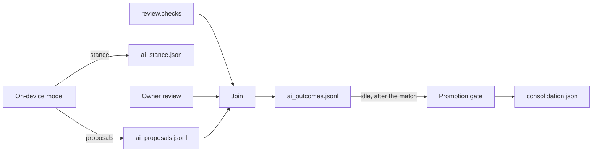

# On-device learning loop

Any model that runs inside QorCap — a score reader, a clip picker, an event labeller, an explanation writer — learns only inside this loop. The model proposes. QorTime's deterministic checks judge. The owner's review can judge too. Those two are the only sources that may update the model. The model's own past outputs are never training data, and they never change a receipt verdict.

`contracts/receipt.v0.json` is frozen. It sets `additionalProperties` to false. This loop adds files beside the receipt. It does not add fields to the receipt, and it does not change verifier logic.

This loop does not open a gamepad. It does not write output reports or feature reports. It does not read or modify controller or console firmware. A device-key status, if a later screen shows one next to these files, stops at `tpm_claimed`.

The shapes below are version `v0`. Each one has a JSON Schema in `schema/`. The first slice that writes them is `sidecar/qorcap_ai_loop.py`.

## Check ids this loop is allowed to cite

Citations use the keys of `review.checks` on a `qortime-bundle-review/v1` object. The official referee writes those keys in `qor_receipt/review/engine.py` (`Submission.review`). They are the same seven keys at QorTime `0204e6d` (the commit QorCap pins) and at `fe4b8dd` (current main, where `verify/receipt-view.js` lists them as `KNOWN_CHECKS`).

| Check id | What the referee's code is doing |
|---|---|
| `bundle_structure` | Recomputes the manifest chain, the checkpoint chain, the inputs chain, and the receipt binding. |
| `capture_chain` | Checks laptop checkpoint countersignatures, and gap and skew limits, against the capture key. |
| `video_bytes` | Hashes the video bytes the referee received against the committed manifest (full upload or spot-check). |
| `final_reread` | Re-reads the recorded tail with the referee's own reader. |
| `challenges` | Re-checks official nonce tokens, the controller-log window, and pause timing on the referee's decode. |
| `motion` | Computes motion correlation. `partial` when the figure is below the floor or was not computed. |
| `input_integrity` | Recomputes controller-log hashes and chains. `partial` when the bundle has no controller log. Human-likeness and alignment are not re-run here. |

Each check's `state` is `pass`, `partial`, or `fail`.

Viewer step ids are a different list (`schema`, `pin`, `refsig`, `trust`, `players`, `review`, `chain`, `dual`, `result`, `tier`, and the panel id `input`). `challenges` and `motion` are the only names that appear in both lists. An explanation that cites `input`, `pin`, `tier`, `corroboration`, or a device-key status is citing something that is not a review check. Unless that exact id is present in the label view for this match, the citation is a miss.

`referee_verdict.json` (`qortime-referee-verdict/v0`, from `qortime referee-ai`) is a model-bearing file. Its `accept` / `dispute` / `abstain` word is not a review check and is not a training label.

Today `final_reread.detail` is prose. This loop does not parse prose. A label carries a machine-readable `value` only when the producer already has a structured read. A `pass` with no `value` cannot confirm a score.

## 1. Proposal, then referee outcome

Three sidecar files, all outside the receipt:

| File | Schema | When it is written |
|---|---|---|
| `ai_proposals.jsonl` | `qorcap-ai-proposal/v0` | As the model proposes, during or after the match. Appending a line does not touch the receipt. |
| `ai_outcomes.jsonl` | `qorcap-ai-outcome/v0` | After a label view exists. One line per proposal. |
| `consolidation.json` | `qorcap-ai-consolidation/v0` | Offline, after the match, when capture is idle. One batch record: promoted or discarded. |

A fourth file, `ai_stance.json`, is specified in section 3. It is the model's stance, not a label.

### Proposal line

One JSON object per line.

| Field | Meaning |
|---|---|
| `schema` | `qorcap-ai-proposal/v0` |
| `proposal_id` | Stable id for this proposal. Unique inside the file. |
| `match_id` | The match the proposal is about. |
| `model_version`, `calibration_version` | The model and the calibration that produced the line. |
| `kind` | `score_read`, `event_label`, `clip_pick`, or `explanation`. |
| `abstain` | Boolean. Required. `true` means the model declined. |
| `confidence_permille` | Integer 0..1000, or `null` when abstaining. No floats. |
| `context` | `game`, `controller_family`, `console`, `capture`. All non-empty strings. |
| `relates_to` | Check ids this proposal is about. |
| `value` | Flat object the referee can compare (`away`, `home`, `quarter`, a clip id, an event name), or `null`. |
| `explanation` | Present for `kind: explanation`, and whenever the model explains. `text` plus `citations` of `{check_id, state}`. |
| `t_ms` | Match clock in milliseconds, integer. |

`context.game` is the game string the bundle already records. `context.controller_family` is an open label. Names this loop expects to see, because capture already distinguishes them: `dualsense`, `dualsense_edge`, `xbox`, `switch_pro`, `pc`. A pad the recorder names with a new label is stored as that label. `context.console` is the HDMI source the recorder names. `context.capture` is the recording path: the USB HDMI card in use today, or later a future dedicated capture device. The string is a label. It does not select device-specific code.

Abstaining is a complete proposal: `abstain: true`, `confidence_permille: null`, `value: null`. The line is still written, so the join can record that the model declined.

### Label view

The join reads a `qorcap-ai-label-view/v0` object. The model does not write this file.

| Field | Meaning |
|---|---|
| `schema` | `qorcap-ai-label-view/v0` |
| `source` | `referee` or `human_review`. |
| `match_id` | Must match the proposals. |
| `checks` | Map of check id to `{state, value?}`. `detail`, when copied through, is ignored. |

`source: referee` means the states came from `review.checks` (and `value` from a structured read the referee already computed). `source: human_review` means the owner decided. Any other source is rejected. So is a document whose schema is a proposal, an outcome, a stance, a consolidation record, or `qortime-referee-verdict/v0`.

### Outcome line

| Field | Meaning |
|---|---|
| `outcome` | `confirmed`, `contradicted`, or `unverifiable`. |
| `pairing` | The value comparison, or `not_applicable` for an explanation. |
| `source` | `referee` or `human_review`. |
| `weight` | `1` for the referee, `3` for the owner. The module assigns this. A file cannot raise it. |
| `trainable` | Whether this line may enter a later update. |
| `checks` | For each id in `relates_to`: whether that check ran, and its state. |
| `grounding` | `grounded`, `miss`, or `not_applicable`. |
| `misses` | Citations that did not match a check that ran. |
| `referee_outcome` | The outcome the referee view alone would have produced, or `absent`. |

Pairing rules for `score_read`, `event_label`, and `clip_pick`, applied to every id in `relates_to`:

| Referee state | Value | Result |
|---|---|---|
| Check absent | | `unverifiable` (`check_not_run`) |
| `fail` | present or absent | `contradicted` (`check_failed`) |
| `partial` | present or absent | `unverifiable` (`partial_check`). Partial is not a confirmation. |
| `pass` | absent, or the proposal has no value | `unverifiable` (`no_independent_value`) |
| `pass` | equal to the proposal | `confirmed` (`value_match`) |
| `pass` | different | `contradicted` (`value_mismatch`) |

One contradicted check makes the proposal contradicted. Confirmation requires every related check to confirm. Anything else is unverifiable.

An abstaining proposal is `unverifiable` with reason `abstain`. It is not trainable. A matching referee value does not turn it into a confirmation.

`trainable` is true only for `confirmed` and `contradicted` lines whose grounding is not a miss and whose source is `referee` or `human_review`. Confirmed lines are the positive labels. Contradicted lines are the negative labels. Unverifiable lines, abstentions, and misses stay in the file and stay out of the update.

These files are not in the vendored upload list (`contracts/compat.json`). They stay on the machine. Putting them in a bundle upload is a QorTime change, described at the end.

## 2. Explanation grounding

An explanation cites check ids and the state it claims for each. `relates_to` is that same list.

The join looks at the checks that actually ran:

- The id is missing from the label view used for grounding: miss, reason `not_run`.
- The id ran and the cited state differs from the recorded state: miss, reason `state_mismatch`. The outcome stores both the claimed state and the actual state.
- Every citation matches a check that ran, with the same state: `grounded`.

A miss invalidates the explanation. The outcome is `unverifiable`, `trainable` is false, and the miss is the outcome line itself (`grounding: "miss"`, `misses` filled in). The module does not rewrite the citation into the state the referee wrote. A later reader can see the false citation.

Grounding uses the referee view whenever the referee ran. The owner's review does not supply substitute states for citations.

A grounded explanation (`kind: explanation`) is `outcome: confirmed` with `pairing: not_applicable`. That confirms the citation, not a score.

## 3. Stance file

`ai_stance.json` (`qorcap-ai-stance/v0`) sits beside the receipt. It is not a receipt field.

| Field | Meaning |
|---|---|
| `stance` | `accept`, `dispute`, or `abstain`. The same three words `qortime referee-ai` uses, on purpose, so logs stay comparable. |
| `proposal_ids` | The proposals this stance covers. |
| `note` | Fixed text: `Model stance. The receipt verdict stays with the referee.` The writer sets it. Callers cannot replace it. |

The stance is the model's position. The join never reads it as a label. `qortime referee-ai` already writes `referee_verdict.json` with the same three words; that file is the other model's output and is rejected as a label source. The two files stay distinct so a stance cannot be mistaken for a signed verdict.

## 4. Consolidation, only when idle

`consolidation.json` is the offline batch record.

| Field | Meaning |
|---|---|
| `candidate`, `current` | `model_version` and `calibration_version` of each. |
| `labelled_matches` | The closed series: match id, source, weight, and the context key. |
| `metrics` | `correct_weight`, `total_weight`, and `accuracy_permille` for the candidate and for the current version. Permille is integer division for display. |
| `per_context` | The same counts for each `game` × `controller_family` × `console`. |
| `decision` | `promoted` or `discarded`. |
| `reason` | Why. |
| `idle`, `during_capture`, `referee_identical` | The conditions the gate was given. |

The promotion gate is a pure function. It does not load weights and it does not swap a model binary. Promotion in v0 means the record says `promoted`.

The labelled series is closed before either version is scored. Both versions are scored on that same set of proposal ids. A proposal one version invents afterwards is not a row.

A row's weight comes from its label source: `1` or `3`. `candidate_correct` / `current_correct` is true only when that version's outcome is trainable and `confirmed`. Abstain, unverifiable, miss, and contradicted are not correct. An abstention on a labelled row therefore counts against the version that abstained.

Comparison uses cross-multiplication of the weights, so a rounded permille cannot promote a tie.

`decision: promoted` requires all of the following:

1. Capture is idle. `during_capture` is false, and a recording-lock age, when the caller supplies one, is at least 30 seconds. That is the same `.qorcap-run/recording.lock` freshness highlights already use (`MARKER_FRESH_S`).
2. `idle` is true. The batch runs after the match.
3. `referee_identical` is true (section 5).
4. The series is non-empty.
5. No context has a lower weighted accuracy than the current version. Equal is not a regression.
6. The candidate's overall weighted accuracy is strictly greater than the current version's.

Otherwise `decision` is `discarded`. The first failing condition sets `reason`: `during_capture`, `not_idle`, `referee_checks_differ`, `no_labelled_matches`, `context_regression`, `not_strict_improvement`. A discarded record is still written when the caller is the offline job, so the batch has an audit line. The record does not apply an update.

The context key is `game` × `controller_family` × `console`. That is the slice that has to hold across DualSense, DualSense Edge, Xbox, Switch Pro, PC pads, and whatever HDMI console the recorder named. `capture` stays on the proposal and the outcome so the path is visible, including a future dedicated capture device. It is not a fourth axis in v0.

## 5. AI-off baselines

Some matches run with the model off: no proposal lines, no stance file. The referee still runs. Its `review.checks` states are stored as the baseline.

The same checks are compared to a match, or a replay of the same bundle, with the model on. `referee_checks_identical` is true only when the two maps have the same ids and the same `pass` / `partial` / `fail` states. An extra check on one side, or a different state, is drift.

The receipt verdict has to be the same with the model on and with the model off, because the model is not an input to the referee. The gate treats a failed comparison as `referee_checks_differ` and discards. v0 compares check states. It does not re-implement the verifier.

## 6. Human review

The owner's decisions are labels with weight `3`. Referee labels have weight `1`. Weight `3` is the maximum the joiner will assign.

When both views exist for one proposal:

- A score, event, or clip proposal takes `source: human_review`, and the pairing follows the owner's view.
- An explanation keeps `source: referee` when the referee ran, because citations are judged there.
- `referee_outcome` records what the referee view alone would have produced, so a disagreement stays visible.
- Citations are still grounded against the referee's states.

A partial owner view does not confirm anything. Weight does not turn `partial` into `pass`. An unverifiable owner line is not trainable.

The owner writes a label view (`source: human_review`). That file is not the receipt, and it does not edit `review.checks`.

## 7. Design analogy

The table is a design analogy for this loop. It is not a claim about how brains learn.

| Analogy | Where it sits in this design |
|---|---|
| Generate | The model writes proposals (score read, event label, clip pick, explanation) and a stance, including an explicit abstain. |
| Verify | `review.checks` and the grounding rules judge the proposal. The model does not verify itself. |
| Modify | Only trainable outcomes may update a later version. Confirmed lines add correct weight. Contradicted lines add total weight and no correct weight. Misses, abstentions, unverifiable lines, and the model's own outputs are not labels. |
| Re-test | The promotion gate scores the candidate and the current version on the same labelled series, overall and per context. AI-off baselines re-check the referee. |
| Reinforcement of confirmed, weakening of contradicted | A confirmed row increases `correct_weight`. A contradicted row increases `total_weight` only, so accuracy falls unless other rows make up for it. |
| Sleep-like offline consolidation | `consolidation.json` is an offline batch. It runs when capture is idle after the match, and the gate discards when capture is live. |
| Varied practice | The series is sliced by game, controller family, and console, so a gain on one pad and one HDMI source cannot hide a loss on another. |
| Dual competence | The model is competent at proposing. The referee's code is competent at judging. An update needs both. The stance file and the check states stay in different files. |
| Unassisted practice | AI-off matches produce no proposals. The referee's check states on those matches are the baseline the assisted run has to match. |

## 8. Match viewer

QorTime's viewer (`verify/receipt-view.js`) already has the display rule these files must follow. Panel states are `pass`, `partial`, `fail`, `absent`, `unchecked`, and `info`. Gold is allowed only when the verifier status is `VERIFIED` (`goldAllowed`). Sidecar files are identified and shown as `info`. The page says they are not checked in the browser. Unknown fields are shown raw and are not scored.

A learning panel would follow that rule:

| On screen | State | What the words say |
|---|---|---|
| No learning files | `absent` | Nothing was attached. |
| Proposals, outcomes, stance, consolidation | `info` | Counts, kinds, context, cited check ids, and the raw outcome word (`confirmed`, `contradicted`, `unverifiable`). |
| Stance | `info` | The stance word, then the fixed note that the receipt verdict stays with the referee. |
| Grounding miss | `info` | The word `miss`, the check id, `not_run` or `state_mismatch`, and the claimed and actual states. |
| Consolidation | `info` | `promoted` or `discarded`, plus the reason and the per-context lines. |
| A cited id that is not in `review.checks` | `unchecked` on that citation | Shown as a miss. It does not become a check state. |

`confirmed` is not drawn as `pass`. `promoted` is not drawn as `VERIFIED`. Neither word is gold. A `tpm_claimed` device row, if the page already shows one, stays the partial device row the viewer has now. These sidecars do not upgrade it.

The browser does not join proposals and does not run the promotion gate. It displays the files. The referee remains the judge.

## First slice

`sidecar/qorcap_ai_loop.py` does four things, and the tests in `sidecar/test_qorcap_ai_loop.py` cover them:

1. Validate and append `ai_proposals.jsonl`.
2. Join proposals to a referee view, an owner view, or both, and append `ai_outcomes.jsonl`.
3. Validate explanation grounding and record a miss on the outcome line.
4. Run the promotion gate and write `consolidation.json`.

It also writes `ai_stance.json` and compares two check-state maps for the AI-off baseline.

It does not train a model, does not call the referee, does not modify `receipt.json`, and does not add these files to the upload list. Fixtures under `sidecar/fixtures/ai_loop/` are synthetic. This repository has no published match bundle to replay.

## What should also land in QorTime

1. **Structured `final_reread` value.** Keep today's `state` and prose `detail`. Add an optional structured value when the referee's reader already has `away` / `home` (and quarter, when it has one), so QorCap can confirm a score without parsing a sentence. Absent value stays unverifiable on this side.
2. **Viewer identification.** Add the `qorcap-ai-proposal`, `qorcap-ai-outcome`, `qorcap-ai-consolidation`, `qorcap-ai-stance`, and `qorcap-ai-label-view` families to the sidecar list in `verify/receipt-view.js`. Render them as section 8 describes: `info` or `absent`, never gold.
3. **Leave `schema/receipt.v0.json` alone.** Learning fields do not belong on the signed receipt.
4. **Say in `docs/REFEREE_AI.md` that `referee_verdict.json` is not a training label.** Integrity errors inside that tool are code; the verdict word mixes in model agreement. On-device learning consumes `review.checks`, not that file.
5. **Upload list, only if these files should ever leave the machine.** `contracts/compat.json` `bundle_files.meta` is owned by QorTime. QorCap vendors it. v0 keeps the learning files local, so the registry stays as it is until QorTime adds them.
