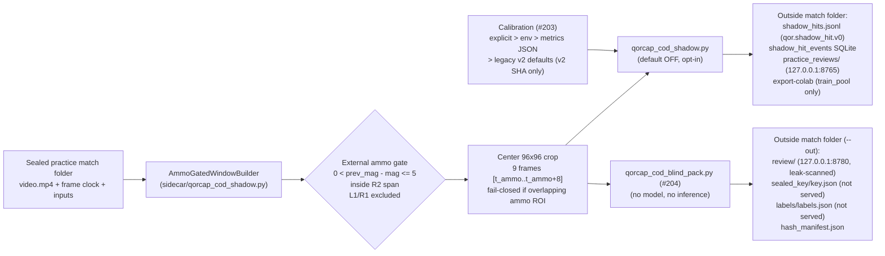

# Call of Duty practice shadow runner and blind label pack (info-only)

Practice-lane, post-match tooling for Call of Duty sessions:

- `sidecar/qorcap_cod_shadow.py` — post-match CPU ONNX shadow spotter, SQLite index sync, active-learning review pack, and Colab export (added in [#201](https://github.com/ConWan30/qorcap/pull/201), configurable calibration in [#203](https://github.com/ConWan30/qorcap/pull/203), shared window builder and crop/ROI guard in [#204](https://github.com/ConWan30/qorcap/pull/204)).
- `sidecar/qorcap_cod_blind_pack.py` — model-free blind H/N/S label pack builder and loopback label server (added in [#204](https://github.com/ConWan30/qorcap/pull/204)).

Both tools are **info-only** and **not Counted**. Neither runs during active capture, neither writes inside a match folder, and neither changes `receipt.v0`, `contracts/`, `bundle.json`, locks, or #199 verdicts. No gold, no referee submit, and no upload.

## Pipeline overview



## Shared window builder and crop guard (#204)

`sidecar/qorcap_cod_shadow.py` defines `AmmoGatedWindowBuilder`, shared by `run_shadow_on_match` and `qorcap_cod_blind_pack.iter_gated_windows` so both emit the exact same candidate windows:

1. **`prepare(frame_idx, frame)`** — validates the frame size once per `(width, height)` with `assert_center_crop_excludes_ammo_roi`, extracts the center `96x96` crop (`CROP_SIZE = 96`), and maps `frame_idx` to `(t_us, t_ammo_ms, span)` using the match frame clock and R2 spans.
2. **`feed(crop)`** — appends the center crop to each open window and yields completed 9-frame windows (`WINDOW_FRAMES = 9`, `[t_ammo .. t_ammo + 8]`).
3. **`gate(frame_idx, t_ammo_ms, span, mag, crop)`** — applies the external ammo-decrease gate `0 < (prev_mag - mag) <= 5` (`MAX_AMMO_DROP_PER_STEP = 5`) inside an R2 span, at most one anchor per `frame_idx`. Spans flagged `equipment_excluded` (L1/R1) are skipped for inference (`("equipment", None)`).

**Ammo ROI isolation (fail-closed):** The bottom-right magazine box (`AMMO_ROI_FRAC = (0.70, 0.92, 0.77, 0.94)`) is read only by `read_ammo_counter` as the external gate and `t_ammo` timing anchor. `assert_center_crop_excludes_ammo_roi` raises `ShadowRunnerError` if the frame is smaller than `96x96` or if the center `96x96` crop overlaps the ammo ROI box. Ammo pixels never enter model tensors or blind review strips.

## Configurable shadow calibration (#203)

The shadow runner (`sidecar/qorcap_cod_shadow.py`) stays **default-OFF**. Its post-match hook (`maybe_run_cod_mnv4_shadow`) runs only when `QORCAP_LANE=practice`, `game == "cod"`, `QORCAP_SHADOW_MNV4` is not disabled (`0`/`false`/`no`/`off`), `QORCAP_SHADOW_MNV4_MODEL` points to an ONNX file, and `QORCAP_SHADOW_SPLIT` is `train_pool` or `fresh_holdout`. Errors in the hook are caught and logged without affecting match save or verification.

PR #203 replaced hard-coded legacy v2 calibration with configurable calibration resolved by `resolve_calibration`:

**Precedence (highest to lowest):**
1. Explicit CLI flags (`--model-id`, `--temperature`, `--tau-low-bps`, `--tau-high-bps`)
2. Environment variables (`QORCAP_SHADOW_MNV4_MODEL_ID`, `QORCAP_SHADOW_MNV4_TEMPERATURE`, `QORCAP_SHADOW_MNV4_TAU_LOW_BPS`, `QORCAP_SHADOW_MNV4_TAU_HIGH_BPS`)
3. Metrics JSON file (`--metrics` or `QORCAP_SHADOW_MNV4_METRICS`)
4. Legacy v2 defaults (`model_id = "cod_gunfire_hit_v2"`, `temperature = 2.9292`, `tau_low_bps = 3500`, `tau_high_bps = 6500`) — **only when the ONNX file's SHA-256 equals `V2_LEGACY_MODEL_SHA256` (`1e2ec29dfbfc9478e4e50a23a252d230f67fca129a6914de91e870788407a0f3`)**

### Fail-closed validation rules

- **Non-v2 models require explicit calibration:** If the ONNX file's SHA-256 does not match `V2_LEGACY_MODEL_SHA256`, `resolve_calibration` raises `ShadowRunnerError` unless `--metrics` / `QORCAP_SHADOW_MNV4_METRICS` or all three of `temperature`, `tau_low_bps`, and `tau_high_bps` are supplied.
- **Metrics JSON binding (`load_model_calibration`):** Reads `temperature`, `tau_low_bps` / `tau_high_bps` (or falls back to `calibrated_gate.tau_low` / `calibrated_gate.tau_high`, rounded to integer basis points), and optional `model_id`. When checked against a real ONNX file, `onnx_sha256` (64 hex chars) is required and must match the model file's SHA-256.
- **Bounds (`validate_calibration`):** `temperature` must be a finite number `> 0`; `tau_low_bps` and `tau_high_bps` must be integers with `0 <= tau_low_bps < tau_high_bps <= 10000`.
- **Override warning:** When `maybe_run_cod_mnv4_shadow` runs with both a metrics JSON and an env/explicit override, it prints a warning with the effective `calibration_source`, `temperature_milli`, and `tau` bounds.
- **No floats in canonical output:** Canonical `qor.shadow_hit.v0` JCS records reject floats (`assert_no_floats`); `practice_reviews/<session_id>/manifest.json` records `temperature_milli` (integer `round(temperature * 1000)`), `tau_low_bps`, `tau_high_bps`, `calibration_source`, and `metrics_path`.

### Shadow runner environment variables

| Variable | Purpose |
|---|---|
| `QORCAP_LANE` | Must be `practice` for the post-match hook to run. |
| `QORCAP_SHADOW_MNV4` | Set to `0`/`false`/`no`/`off` to disable the hook even if model/split are set. |
| `QORCAP_SHADOW_MNV4_MODEL` | Path to the ONNX model file. |
| `QORCAP_SHADOW_MNV4_METRICS` | Path to `train_metrics_*.json` with `temperature`, tau gates, and `onnx_sha256`. |
| `QORCAP_SHADOW_MNV4_MODEL_ID` | Overrides `model_id` from metrics JSON or default. |
| `QORCAP_SHADOW_MNV4_TEMPERATURE` | Overrides softmax temperature (`> 0`, finite). |
| `QORCAP_SHADOW_MNV4_TAU_LOW_BPS` | Overrides `NO_HIT` upper threshold (`0..10000`). |
| `QORCAP_SHADOW_MNV4_TAU_HIGH_BPS` | Overrides `GUNFIRE_HIT` lower threshold (`0..10000`). |
| `QORCAP_SHADOW_SPLIT` | Required split: `train_pool` or `fresh_holdout` (hard firewall on `export-colab`). |
| `QORCAP_SHADOW_DB` | SQLite path (defaults to `D:\QorCap\index\sessions_index.sqlite` if its parent exists, else under output root). |
| `QORCAP_SHADOW_OUT` | Output root outside the match folder (defaults to `%LOCALAPPDATA%\QorCapShadow` or `~/.local/share/QorCapShadow`). |

### Shadow runner CLI

```
python sidecar/qorcap_cod_shadow.py analyze --match-dir <match> --split train_pool --model <model.onnx> [--metrics <train_metrics.json>] [--temperature T --tau-low-bps LOW --tau-high-bps HIGH] [--out <dir>] [--db <sqlite>] [--inputs <path>] [--no-clips]
python sidecar/qorcap_cod_shadow.py serve --review-dir <review_dir> --db <sqlite> [--port 8765]
python sidecar/qorcap_cod_shadow.py label --db <sqlite> --event-id <id> --key H|N|S [--manifest <manifest.json>]
python sidecar/qorcap_cod_shadow.py export-colab --db <sqlite> --out <dir> [--split train_pool] [--session-id <id>]
```

## Blind label pack builder (#204)

`sidecar/qorcap_cod_blind_pack.py` builds a blind H/N/S label pack for one CoD practice match folder (`session`) or one stored window row (`row`) without loading any model or running inference.

### Guardrails

- **No inference (exit 2):** `refuse_inference_args` rejects `--model`, `--model-id`, `--metrics`, `--onnx`, `--pt`, `--weights`, `--checkpoint`, `--temperature`, `--tau`, `--tau-low-bps`, `--tau-high-bps`, `--score`, `--infer`, and any `.onnx`, `.pt`, or `.pth` argument before parsing.
- **No overwrites, outside match folder:** `--out` must sit outside `--match-dir` (`_ensure_out_outside_match`), and the builder refuses to overwrite a non-empty `review/` folder.
- **Headless strips, seeded shuffle:** Strips are rendered with `render_composite_strip(..., header_text="")` (`892x304` PNG) and shuffled with `random.Random(seed).shuffle`. Strip IDs are `s001..` with no session, frame, or time order exposed. No video clips are extracted.
- **Single-row mode (`row`):** Reads only the `windows` array (`(N, 9, H, W, 3)` BGR center crops) from an `.npz` file (`allow_pickle=False`). Label, tier, and score arrays are never read.
- **Unblinding leak scan (`scan_for_leaks`):** Scans every path name, text file, and PNG non-image chunk under `review/` for model/score/threshold/tier/triage/frame/session tokens and session-shaped strings (`match-<digits>`, `YYYYMMDD-HHMMSS`). The build fails (`BlindPackError`) if anything matches.
- **Loopback-only server (`serve`):** Binds `127.0.0.1` only (default port `8780`) and serves `review/` only. `POST /label` accepts `{id, key}` where `key` is `H` (`GUNFIRE_HIT`), `N` (`NO_HIT`), or `S` (`SKIP`), and writes atomically to `labels/labels.json` outside the served folder.

### Output layout under `--out`

| Path | Served? | Contents |
|---|---|---|
| `review/review.html` | Yes (`127.0.0.1`) | Blind H/N/S UI (hotkeys `H`, `N`, `S`). |
| `review/manifest.json` | Yes (`127.0.0.1`) | `schema: qor.blind_label_pack.v0`, `info_only: true`, `count`, `items: [{id, png}]`. |
| `review/strips/sNNN.png` | Yes (`127.0.0.1`) | Headless `892x304` composite strips in shuffled order. |
| `sealed_key/key.json` | No | `schema: qor.blind_label_key.v0`, maps `sNNN` to `session`/`frame`/`t_ammo_ms` (or `npz`/`row`). No scores. |
| `labels/labels.json` | No | Map of `sNNN` -> `GUNFIRE_HIT` / `NO_HIT` / `SKIP`, written by `serve`. |
| `hash_manifest.json` | No | `schema: qor.blind_label_hashes.v0`, deterministic path, byte size, and SHA-256 of every file in `review/` and `sealed_key/`. |

### Blind pack CLI

```
python sidecar/qorcap_cod_blind_pack.py session --match-dir <match> --out <out> --seed <int> [--inputs <path>]
python sidecar/qorcap_cod_blind_pack.py row --npz <windows.npz> --row <N> --out <out> [--seed 0] [--windows-key windows]
python sidecar/qorcap_cod_blind_pack.py serve --out <out> [--port 8780]
```
